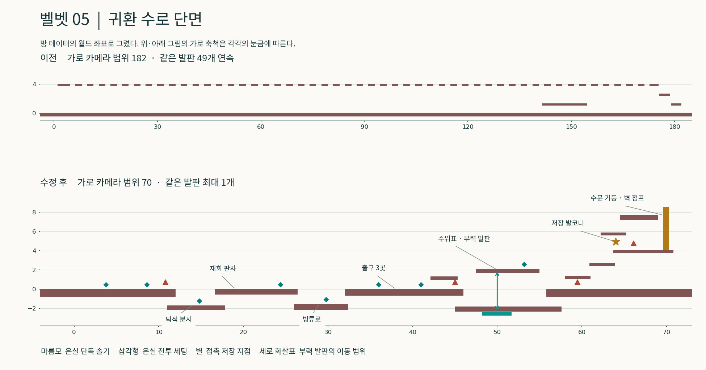

# 레벨 디자인 패스 2 — 벨벳 귀환 수로와 구역별 귀환 동선

## 목표

벨벳 05의 같은 높이 점프 행렬을 수로의 하강·도하·상승 동선으로 바꾸고, 미하일전 직후 은실 80회를 벨벳 여러 방에서 채울 수 있게 하는 작업이다. 시계탑·오페라·대종루·화랑에서는 07·08 귀환 방과 정거장이 있는 방 전부에 같은 기준을 적용했다. [품질 기준 §3](../../31-quality-standard.md) · [이전 검증 기준선](LEVEL-STEP6-FIX4-REPORT.md)

## 변경

수로의 동일 발판 최대 연속 수는 **49개에서 1개**, 가로 카메라 범위는 **182에서 70유닛**으로 줄었다. 서쪽 부두에서 퇴적 분지로 내려가 재회 판자를 지나고, 방류로와 수위표를 따라 동쪽 건선거의 저장 발코니로 오른다. 은실 전투는 입구 부두, 방류구, 건선거, 저장 발코니에 한 명씩 배치했다. 수위표 아래 부력 발판을 타면 상부 점검로로 올라간다. 고정 턱으로도 점검로에 닿는다. 저장 발코니 위 수문 기둥에서는 벽을 타고 덮개로 바로 건너갈 수 있다. [수로 데이터](Assets/Resources/Story/representative.json) · [수위표와 수면 구현](Assets/Scripts/Story/RepresentativeRoomLayout.cs)

기존 수로의 상부 천 발판 50개와 검사대를 걷어내고 고정 제방·수로 바닥·사다리식 턱·부력 발판을 배치했다. 저장 지점 `waterway_splice_floor`는 새 발코니 x=64에 있다. 네 출구의 좌표, 접근 범위, 목적지, 게이트와 재회 판자·걸쇠의 좌표는 보존했다. 벨벳 01의 옷본 선반, 02의 베틀 가로대, 03의 커튼 상부, 04의 경기장 상부에 실제 틈을 건너는 은실 경로를 만들었다. 수로의 해제 매듭 3개는 01·02·04에 하나씩 배치했다. [방·체크포인트·출구](Assets/Resources/Story/representative.json)

### 벨벳 첫 귀환 은실 공급

첫 귀환은 미하일에게 은실을 받은 뒤 중간 조사로 이동하기 전까지다. 열린 문을 따라 **05 → 01 → 02 → 03 → 04**를 한 번씩 지난다. 06으로 들어가는 두 문은 모두 조사 완료가 조건이므로 이 시점의 공급은 0회다. 아래 수치는 세팅 후 베기로 다음 장갑 마디를 여는 경우를 포함한다. 같은 솔기의 재설치, 방 재입장, 전투 대상 재생성으로 횟수를 늘리지 않았다. [동선 안내](Assets/Scripts/Story/FirstDeparture.cs) · [방별 공급 재생](tools/validate_level_step2.py)

| 벨벳 방 | 단독 솔기 | 설치 후 지지 접촉 | 전투 세팅 | 가능한 합계 | 봇 경로의 사용 / 누적 |
|---|---:|---:|---:|---:|---|
| 01 입구 | 8 | 8 | 8 | 24 | 24 / 40 |
| 02 베틀 | 0 | 12 | 12 | 24 | 12 / 52 |
| 03 회랑 | 0 | 12 | 12 | 24 | 12 / 64 |
| 04 경기장 | 0 | 16 | 0 | 16 | 16 / 80 |
| 05 수로 | 8 | 0 | 8 | 16 | 16 / 16 |
| 06 상부 숏컷 | 0 | 0 | 0 | 0 | 조사 후 개방 |
| **합계** | **16** | **48** | **40** | **104** | **80** |

05와 01에서 경비병 네 명씩에게 두 번씩 따로 시전한다. 01의 네 명은 은실 획득 후 첫 귀환에 등장한다. 지정 경로는 01에서 30회에 도달하고, 04에서 48번째 지지 접촉으로 누적 유효 사용 80회에 도달한다. 02·03에서는 경비병 세 명의 네 마디씩을 별도로 세팅할 수 있어 24회의 여유가 생긴다. **필요량 대비 여유는 24/80 = 30%**이고 한 방의 최대 비중은 **24/104 = 23.1%**다. [은실 단계·사거리](Assets/Resources/Skills/catalog.json) · [전투 마디 판정](Assets/Scripts/Waves/WaveTargetState.cs) · [첫 귀환 재생](tools/validate_flow_assembly.py)

### 귀환 방과 정거장 전수 측정

화살표 양쪽은 작업 전·후다. 정거장 수는 방에 배치한 `stationMarks`의 수다. 이동 방식은 해당 진행 시점에 쓸 수 있는 경로를 셌고, 한 방에서 선택할 수 있는 역방향·숏컷도 포함했다. 은실과 물감으로 만든 임시 지지를 밟는 동작은 한 종류로 합쳤다. [측정 코드](tools/validate_level_design.py) · [방별 원자료](STATIC-VALIDATION.json)

| 구역·방 | 같은 발판 최대 연속 | 정거장 수 | 이동 방식 수 | 수정 후 확인한 방식 |
|---|---:|---:|---:|---|
| 벨벳 05 수로 | 49 → 1 | 0 → 0 | 3 → 4 | 일반 점프, 낙하, 부력 발판, 벽타기·벽 점프 |
| 시계탑 07 상부 귀환 | 1 → 1 | 42 → 42 | 3 → 3 | 일반 점프, 낙하, 진자 돌진·되감기 |
| 시계탑 08 하부 귀환 | 1 → 1 | 42 → 42 | 3 → 3 | 일반 점프, 낙하, 진자 돌진·되감기 |
| 시계탑 09 숏컷 | 1 → 1 | 3 → 3 | 4 → 4 | 일반 점프, 낙하, 진자 이동, 임시 지지 |
| 오페라 07 옥상 | 1 → 1 | 42 → 42 | 3 → 3 | 일반 점프, 낙하, 왈츠 상승 |
| 오페라 08 로비 | 1 → 1 | 42 → 42 | 3 → 3 | 일반 점프, 낙하, 왈츠 상승 |
| 오페라 09 숏컷 | 1 → 1 | 3 → 3 | 4 → 4 | 일반 점프, 낙하, 왈츠 상승, 임시 지지 |
| 대종루 07 종실 | 1 → 1 | 42 → 42 | 2 → 3 | 일반 점프, 낙하, 균형추 탑승 |
| 대종루 08 지하실 | 1 → 1 | 42 → 42 | 2 → 3 | 일반 점프, 낙하, 균형추 탑승 |
| 대종루 09 숏컷 | 1 → 1 | 4 → 4 | 3 → 3 | 일반 점프, 낙하, 은실 지지 |
| 화랑 07 화실 | 10 → 4 | 40 → 40 | 3 → 3 | 일반 점프, 낙하, 물감 지지 |
| 화랑 08 회랑 | 8 → 3 | 40 → 40 | 3 → 3 | 일반 점프, 낙하, 물감 지지 |
| 화랑 09 테라스 | 1 → 1 | 4 → 4 | 2 → 3 | 일반 점프, 초상 발코니에서 낙하, 임시 지지 |

대종루 07·08에서는 각 방의 7·21·35번째 정거장을 아래쪽 받침으로 옮기고, 두 번째 층에 실제로 타고 오르는 균형추를 설치했다. 화랑 07·08은 한 층의 도중에 마른 받침을 둘로 나눠 1.45유닛 오르는 구간과 1.25유닛 내려가는 구간을 층마다 번갈아 배치했다. 물감을 밟고 착지한 뒤 다음 시전 높이로 옮겨야 한다. 화랑 09에서는 방어병과 반사 석상을 초상 발코니로 옮겨 전투 후 저장 바닥으로 내려오게 했다. [대종루 배치](Assets/Resources/Story/bell.json) · [화랑 배치](Assets/Resources/Story/gallery.json)

`FirstDepartureBot`의 SafeReturn은 솔기의 시전 면과 반대편 착지 면을 실제 지형에서 찾는다. 벨벳 probe는 여섯 저장 접촉의 순서와 조사 후 숏컷 경로를 유지하고, 첫 귀환 다섯 방의 순서·첫 표적·30회와 80회의 방·중복 시전을 검사한다. 대종루 probe는 두 균형추의 탑승을, 화랑 probe는 지정 물감 지지 순서와 초상 발코니 접촉을 요구한다. 시계탑과 오페라의 정거장 경로는 측정 기준 안에 있었고, 두 probe가 은실 획득 후 수로에서 허브로 나가는 공통 문 접근은 새 고정 지형을 사용한다. [귀환 봇](Assets/Scripts/AutoTest/FirstDepartureBot.cs) · [벨벳 probe](Assets/Scripts/AutoTest/VelvetDistrictProbe.cs) · [대종루 probe](Assets/Scripts/AutoTest/BellDistrictProbe.cs) · [화랑 probe](Assets/Scripts/AutoTest/GalleryDistrictProbe.cs) · [공통 문 접근](Assets/Scripts/AutoTest/ClockTraversal.cs)

## 검증

- 작업공간 루트에서 `python3 -B tools/validate_gamedev.py --output unity/RewindNotary/STATIC-VALIDATION.json`을 실행했다. **11,146건 통과, 실패 0건, 기존 경고 25건**이다. 기준선 10,984건과의 차이 162건은 전 방 연속 발판 검사 56건, 감사 대상 13개 방의 이동 방식·정거장 검사 26건, 수로 부력 발판·벽 점프 착지 2건, 벨벳 공급 검사 순증 3건, 현재 지형 대조 56건 및 화랑 고정면 도달 검사 19건이다. [전체 결과](STATIC-VALIDATION.json)
- 전 방 검사에서 같은 높이의 발판을 x순으로 정렬한 뒤 너비와 두께가 같은 연속 구간을 센다. 높이·규격 비교 범위는 0.005유닛이다. `python3 -B /tmp/ldp2/boundary.py`로 영구 검사 진입점에 역순으로 넣은 동일 발판 6개는 실패 0건, 7개는 해당 방 실패 1건이었다. [영구 검사](tools/validate_level_design.py)
- 20ms 고정 틱 재생에서 다섯 방의 장거리 솔기 48곳 각각에 대해 시전할 고정 바닥, 설치한 상판으로의 착지, 설치 수명, 반대편 고정 바닥, 일반 점프 우회를 확인했다. 같은 검증 명령에서 실행한 수로 재생에서는 부력 발판의 이동 범위가 y=−2.4~2.0이었고 상부 점검로에 착지했다. 수문 기둥에서는 미끄러짐 3틱 뒤 벽 점프 한 번으로 덮개에 착지했다. [수로의 이동·착지 재생](tools/validate_level_design.py) · [은실 검사](tools/validate_level_step2.py)
- 기존 QA24 에디터 지형 실측 435개는 당시 설계로 재생했다. 현재 설계의 491개 지형은 작성 크기와 렌더링·충돌 경계의 정적 모델을 대조해 불일치 0개였다. 물리 허용 오차 0.005, 무진전 18초, 구역 정체 120초, 구역 제한 1,500초를 보존했다. [지형 검증](tools/validate_terrain_bounds.py) · [봇 시간 판정](Assets/Scripts/AutoTest/AutoTestDriver.cs)
- 작업 전 복사본과 6개 스토리 파일의 `rows` 시작부터 파일 끝까지를 바이트로 대조했다. 321행과 뒤에 오는 연결 데이터가 일치했다. 전체 방의 출구 배열, 저장 바닥 ID 및 접촉 저장 지정도 대조했다. 로컬에 Unity 에디터와 C# 컴파일러가 없어 Play Mode 봇 완주, 실제 프레임 시간, Game 뷰 스크린샷은 확인하지 못했다. 첨부 이미지는 작성 좌표로 그린 단면도다. [수로 단면 PNG](LEVEL-DESIGN-PASS2-WATERWAY.png)

## 판단 근거

연속 발판 수·정거장 수·공급 수는 방 데이터에서 측정했고, 점프·낙하와 은실 지지 가능 여부는 현재 캐릭터의 속도·중력·충돌체 크기를 적용한 정적 재생 결과다. 낙하는 고정면 끝을 걸어서 벗어나 1유닛 이상 아래 고정면으로 내려가는 경우를 셌다. 제자리에서 스위치를 작동시키거나 같은 높이로 걷는 동작은 이동 방식 수에 넣지 않았다. 본편 56방 전체에 연속 6개 상한을 적용했다. [방별 지형 측정](tools/validate_level_design.py)

은실 예산은 별도의 시전으로 성장하는 전투 마디와 솔기만 합산했다. 진행 상태를 저장·복원하는 정적 동선 재생에서 누적 횟수는 16 → 40 → 52 → 64 → 80이었다. 기존의 ‘수로 한 방에서 80회’ 계산과 50개 같은 높이 지지를 전제로 한 코드·설명 주석을 제거하고 새 동선 검사로 교체했다. 과거 해시와 QA24 측정은 변경 전 원문을 복원해 재검증한다. [귀환 재생](tools/validate_flow_assembly.py) · [이전 원문 대조](tools/story_link_baseline.py)

## 남은 일

Unity에서 SafeReturn과 다섯 구역 probe를 실행해 실제 지지 접촉·방 전환·저장 성공·완주 시간을 확인해야 한다. 사용자 실기에서는 수위표를 보고 이동 발판과 고정 우회를 구분할 수 있는지, 분산된 전투와 이동이 점프 반복 체감을 줄였는지가 남았다. 푸시 매니페스트를 바이트로 다시 읽어 Unity 저장소 상대 경로 29개, 1,044바이트, 마지막 바이트 NUL을 확인했다. 모든 대상 파일이 존재하고 중복·자기 참조는 0개다. 푸시는 메인 담당이다. [푸시 매니페스트](../../push-paths-level-design-pass2.bin)
