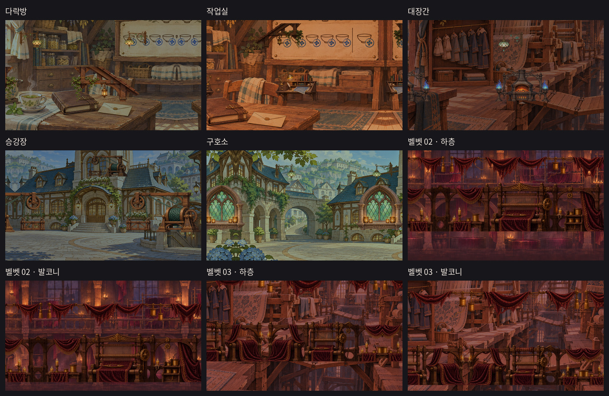

# 레벨 패스 1단계 복구 결과

**정적 검증 7,385건 통과, 실패 0건.** 인수 시점의 7,350개 검사 항목을 모두 유지했다. 벨벳 02·03은 20ms 물리 참조 계산에서 각각 고정 발판만으로도, 벽 점프 1회로도 같은 발코니에 도달했다. 03에서는 벽 경로가 2.22초 짧았다. [전체 정적 결과](STATIC-VALIDATION.json)

**현재 빌드의 Unity 완주 판정은 보류한다.** 이 작업환경에는 에디터·플레이어·C# 컴파일러가 없다. 이전에 사용한 PC 러너로 읽기 전용 연결을 시도했으나 SSH 프록시 소켓을 열 때 `PermissionError [Errno 1]`이 발생했다. 이번 빌드의 `report.json`과 Game 뷰 캡처는 생성되지 않았다. 두 경로의 실기 완주, 실제 슬롯 복귀, 9단계·feel 3종 회귀, 탐험 복귀점 3~5분 간격은 미측정이다.

## 중단 시점 인벤토리

| 원 지시서 범위 | 01:21 중단 전에 있던 파일과 동작 | 복구 후 마무리한 부분 |
|---|---|---|
| 1. 데이터 확장 | `representative.json`, `RepresentativeScript.cs`에 문·층·카메라·지형·배치점 필드가 있었다. `RepresentativeArea.cs`, `RepresentativeRoomLayout.cs`, `DistrictRoomLayout.cs`, `FirstDeparture.cs`가 문 선택·이동·도착·안내를 처리했다. `StoryTerrain.cs`, `AuthoredSurface.cs`, `StoryMovingSurface.cs`, `WaveTarget2D.cs`가 지형·활성 구역·접촉 저장을 구현했다. `CameraTarget2D.cs`, `GameBootstrap.cs`, `ParallaxBackground.cs`가 현재 방을 참조했다. | 03 하층 문 입력, 02 하층 문에서 지정한 03 도착 바닥, 슬롯 ID와 바닥 영수증, 재접촉 쓰기 횟수를 하네스 판정에 연결했다. 성공한 접촉 저장 시각을 기록한다. |
| 2. 벽 이동 | `PlayerController2D.cs`에 해금·접촉 법선·미끄러짐·반동, `CombatMotor2D.cs`에 저작면 접지, `SpriteAnimator.cs`에 벽 자세가 있었다. 대장간 출구 옆 연습 기둥과 턱도 배치돼 있었다. | 공중 대시 재충전 시 발밑 후보의 상단 높이와 **그 후보 콜라이더 자체의 접촉**을 함께 검사한다. 이전 판정은 인접한 다른 벽과의 접촉도 지면 접촉으로 셀 수 있었다. |
| 3. 벨벳 파일럿 | 02·03의 고정 턱 두 개·발코니·기둥, 03 도착 선반, 같은 x의 층별 문, 06에서 02 상층으로 돌아오는 연결이 있었다. 적·걸쇠 그림은 `velvet-roster.png`에 있었다. | 지형과 배치점을 보존했다. 두 경로의 출발·도착 좌표를 따로 남겨 비교하고, 벽 반동의 조향 잠금과 미끄러짐 상한을 참조 계산에 반영했다. |
| 4. 방별 배경 | `room-sets.json`과 배경 PNG 6장, 각 Unity 메타가 있었다. 거점 5방과 벨벳 2방 모두 원경·중경·근경을 지정했다. | 7개 세트의 자원·UV·투명도·색조를 검사하고, 같은 x에서 실제 자산을 합성해 방별 차이와 두 발코니 높이의 구도를 확인했다. |
| 5. 하네스 | `PilotProbe.cs`, `AutoTestDriver.cs`, `AutoTestReport.cs`, `AutoTestRuntime.cs`에 두 경로·벽 입력·저장 재읽기·R 재시도·최종 실패 처리가 있었다. | 경로 도중 재시도는 실패 처리한다. Q·패링과 점프의 실제 입력 에지, 벽 경로의 기술 발동·성장 0회, 접촉 저장 1회를 검사한다. 경로 판정 직후 중간 JSON을 발행하고 실패 시 방·단계·원인을 남긴다. |

인수 당시 이미 검증 도구 7개가 변경돼 있었다. `validate_level_step1.py`와 `validate_gamedev.py`가 새 검사를 실행했고, `validate_area_links.py`, `validate_autotest.py`, `validate_feel_pass.py`, `story_link_baseline.py`, `level-step1-extensions.json`이 기존 데이터·소스 기준선과 대조했다. 7,225건에서 늘어난 125건은 전용 검사 97건과 신규 에셋·스크립트의 메타·GUID·C# 구분자 검사 28건이다. 전용 검사 97건 중 43건이 변조 검출이었다. 복구 후에는 `validate_dash_parry.py`도 같은 바닥의 접촉을 검사한다. 원래 보호 해시를 유지하고 접지 코드 변경분의 역패치를 갱신했다.

## 확장 필드와 기존 방의 기본값

좌표 단위는 Unity 월드 유닛이다. `StoryRect`의 `x, y`는 왼쪽 아래이며, `width, height`가 모두 양수일 때 정의된 사각형으로 취급한다. 가장자리도 사각형 안에 포함한다.

| 저작 필드 | 동작 | 생략 시 |
|---|---|---|
| `exits[].approach`, `destinationFloor` | 플레이어 발 좌표가 사각형 안에 있고 스토리 조건이 열린 문을 선택한다. 목적 방의 바닥 ID를 저장하고 그 바닥의 x·상단에 도착한다. | 기존 x 거리 1.25 이내 판정, 목적 방 첫 바닥 |
| `floors[].surface`, `terrain[].id/rect/oneWay/wallJump` | 바닥을 저작면에 연결한다. 고정면 도착 높이는 상단 +0.05다. `travelX/travelY`가 0이 아닌 면은 양수 `period` 초 주기의 키네마틱 이동면이다. | 기존 방 지형과 도착 높이, 벽 점프 허용면 없음 |
| `cameraBounds`, `hasFallLine`, `fallLine` | 카메라 추적점의 x·y 한계와 추락 재시작선을 정한다. 파일럿 두 방은 x 0~44, y 1.5~9.0, 추락 조건 y < −10을 사용한다. | x 0~53, y 1.5~5.5, y < −7에서 재시작 |
| `backgroundSet` | 방 진입 시 `room-sets.json`에서 세트를 읽는다. 각 층은 `resource, crop, tint, factor, vertical, height, bottom, spacing, offset`으로 그림·높이·시차를 지정한다. | 기존 `stage1-far/mid` 두 띠 |
| `roster[].placementIds[]`, `placements[].id/x/y/active` | 적·걸쇠 한 개체에 배치점 하나를 연결한다. 발이 활성 사각형에 들어오면 그 위치에서 예고·공격·판정이 작동한다. 02와 03에 각각 7개가 있다. | 기존 순번 기반 위치와 상시 활성 |
| `floors[].contactSave` | 안전 상태에서 지정한 고정면 상단에 실제로 접촉하고 바닥 표시 x의 0.8 이내에 들면 저장한다. 같은 체크포인트 재접촉은 쓰기를 생략한다. | 기존 문 이동·장면 행동·보상 저장 |

저장에는 v4의 `lastStageId`와 `scene_floor:<stage>:<floor>` 영수증을 사용한다. 파일럿 복귀점은 03 발코니의 `gallery_balcony_floor`다. 방 56개·원문 321행과 조건·보상 데이터의 해시를 확인했다. 시계탑·오페라·대종루·화랑·최종 구간의 방 데이터도 인수 전 기준 해시와 일치한다. [방 데이터](Assets/Resources/Story/representative.json) · [필드 정의](Assets/Scripts/Story/RepresentativeScript.cs) · [접촉 저장](Assets/Scripts/Story/StoryTerrain.cs)

## 벽 미끄러짐과 벽 점프

대장간 `intro_forge / 04_ethan_truth`가 `intro_complete`를 저장하면 기본 체술이 열린다. 출구 x=20 동쪽의 x=25.5 연습 기둥에서 기존 점프 키를 다시 눌러 x=21.4~23.6의 턱으로 박찰 수 있다. 별도 키나 성장 영수증은 추가하지 않았다.

| 판정 | 설정값 |
|---|---|
| 벽 인식 | 공중에서 저작된 고정 벽 옆면과 접촉, 법선의 가로 성분 절댓값 ≥ 0.9, 벽 방향 입력 > 0.25 |
| 미끄러짐 | 하강 중 최대 2.2유닛/초. 중력 배율 3을 유지하며 지면까지 계속 내려온다. 벽 자세 기울기 12° |
| 박차기 | 반대 방향 7유닛/초, 위쪽 13유닛/초, 초기 방향 유지 0.14초. 같은 쪽 벽의 재박차기는 착지 또는 반대쪽 박차기까지 제한 |
| 일반 이동 | 속도 6.5, 일반 점프 초속 12, 코요테·점프 버퍼 각각 0.10초, 물리 간격 0.02초 |
| 입력·자원 | 공격·피격 경직·방어·기술 동작 중 벽 박차기를 차단한다. Q 동시 입력은 시전이 소유한다. 벽 접촉·박차기 자체의 기술 발동과 성장 횟수는 0이어야 한다. 공중 대시는 착지에서 충전한다. |

방 경계·보스 봉쇄면·움직이는 면·임시 은실과 물감·일방향 턱에는 박차기 표지가 없다. [이동 입력](Assets/Scripts/PlayerController2D.cs) · [접지와 대시 충전](Assets/Scripts/CombatMotor2D.cs)

## 벨벳 두 경로와 복귀점

아래 값은 저작 좌표와 이동 상수로 계산한 **20ms 참조 궤적**이다. 고정 경로는 걸쇠로 열린 다리를 전제로 두 턱을 밟는다. 벽 경로는 하층에서 기둥까지 걸어가 하강 중 3틱을 관찰하고 한 번 박찬다. 이동 시간에는 전투·입력 프레임 대기·세이브 I/O가 포함되지 않는다.

| 방·경로 | 출발 (x, y) | 착지 순서와 높이 | 공통 도착 (x, y) | 박차기 | 이동 시간 |
|---|---|---|---|---:|---:|
| 02 고정 | (15.6, 0) | 턱 1.30 → 턱 2.60 → 발코니 | (36.8, 3.90) | 0 | 3.70초 |
| 02 벽 | (15.6, 0) | 기둥 → 발코니 | (36.8, 3.90) | 1 | 5.38초 |
| 03 고정 | (30.4, 0) | 턱 1.40 → 턱 2.85 → 발코니 | (36.8, 4.25) | 0 | 5.32초 |
| 03 벽 | (30.4, 0) | 기둥 → 발코니 | (36.8, 4.25) | 1 | 3.10초 |

02의 x=37 하층 문은 걸쇠를 열면 03의 도착 선반으로 이어진다. 같은 x의 상층 문은 조사 완료 후 06으로 이어진다. 06에서는 04 아레나로 진행하거나 02 상층으로 돌아올 수 있다. 03의 x=37 상층은 아레나, 하층은 미하일 격파 후 05 귀환로다. 02는 기둥까지 돌아가므로 벽 경로가 1.68초 더 걸리고, 03은 걸쇠에서 기둥으로 직행할 수 있다. [파일럿 궤적과 변조 검사](tools/validate_level_step1.py)

실기 하네스는 같은 방을 두 번 걸어 출발 x와 도착 x의 경로 간 차이 ≤ 0.4, 도착 y 차이 ≤ 0.12를 요구한다. 발코니 접촉, 고정 턱 2개, 벽 박차기 1회, 공중 대시 소비 유지와 착지 충전, Q·패링 우선순위, 피격 직후와 다음 물리 틱의 넉백·중력을 관찰한다. 03에서는 격리 슬롯을 다시 읽고, 하층의 F 입력으로 상층 문이 열리지 않는지 확인한 뒤 R로 저장한 발코니에 복귀한다. 비교 주행 종료까지 접촉 저장은 한 번이어야 한다. 측정값은 `report.json`의 `pilot.loom`, `pilot.gallery`, `pilot.slotReadback`, `pilot.retryOnBalcony`, `pilot.contactWrites` 등에 들어간다. [하네스](Assets/Scripts/AutoTest/PilotProbe.cs)

복귀점 간격은 01 초입부터 03의 첫 접촉 저장까지의 실제 경과 시간에서 02의 반복 비교 주행을 뺀다. `pilot.entryToContactSeconds`와 `pilot.checkpointInterval`이 180~300초 목표에 대한 결과를 남긴다. 이 필드는 탐험 페이스 관측값이며 경로 완주 판정과 독립적이다. 이번 단계에서 3~5분 간격이나 벨벳 전체 플레이 시간은 입증되지 않았다.

## 배경 분리 범위

| 방 | 원경 | 해당 방에서 보이는 차이 |
|---|---|---|
| 다락방 | `attic-branch` | 낮은 채도의 실내, 책과 찻잔, 들보 램프 |
| 작업실 | `attic-branch`의 다른 구도 | 호박색 조명, 벽 도면과 작업대 |
| 대장간 | `tailor-workshop` | 어두운 작업장, 화로와 청색 불꽃 |
| 승강장 | `lapis-plaza` | 푸른 광장 건축, 도르래와 권양기 |
| 구호소 | `lapis-plaza`의 다른 구도 | 녹색 석조 아치, 꽃과 채색 유리 |
| 벨벳 02 | `dyehouse` | 깊은 버건디 염색장, 직조기와 촛불 금색 천 장식 |
| 벨벳 03 | `tailor-workshop` | 목조 재단 작업장, 다른 높이의 천과 금색 실타래 |

거점의 가로 시차 계수는 0.12 / 0.44 / 0.75, 벨벳은 0.11 / 0.40 / 0.73이다. 컨셉 원화 세 장을 원경에 사용하고 거점 중·근경은 `hub-props`, 벨벳 중·근경은 `loom-strips`의 투명한 부분 그림을 사용한다. 세트마다 자르기·색조·배치 간격·높이가 다르다. 같은 원화와 소품을 공유하는 방에서는 건축이나 장식이 반복되고, 가로 타일 경계에서 좌우 반전이 보인다. 이번 적용 범위는 7개 방이다. 아래 비교표는 x=37에서 카메라 높이를 달리한 배경 합성이다. 캐릭터·충돌체·HUD를 겹친 Game 뷰의 가독성은 실기 확인이 남았다. [배경 세트](Assets/Resources/GameArt/backgrounds/room-sets.json) · [배경 비교 이미지](LEVEL-STEP1-BACKGROUNDS.jpg)

## 회귀와 전달 파일

- **정적 회귀**. 인수 시점의 7,350개 검사명을 최종 결과와 중복 개수까지 대조했다. 누락 0개다. 레벨 전용 검사는 97개에서 132개로 늘었고 변조 69/69건을 검출했다. 실제 소스 사본에서 대장간 조건 반전, 다른 바닥을 이용한 충전, 문 y판정 삭제, 접촉 저장 삭제, 최종 판정 삭제, 출발점 비교 삭제를 각각 주입해 여섯 경우 모두 해당 검사가 실패하는 것도 확인했다.
- **9단계와 feel**. 하네스 정적 계약은 72/72건, feel 계약은 22건과 변조 53/53건을 통과했다. 정체 감시는 18초를 유지한다. 변경 전 PC 실행 `testresults/run5/report.json`에서는 Unity 6000.6.9f1에서 9/9단계와 feel 3/3이 통과했다. 당시 지상 정지는 0.02초, 공중 정지는 0.22초에 속도 0.34, 정지 공격은 입력 프레임에 1회였다. 이번 코드의 실기 결과는 아직 없다.
- **푸시 범위**. `push-paths-level-step1.bin`은 기존 푸시와 같은 Unity 프로젝트 루트를 기준으로 한다. 중단 전 Unity 파일 40개, 검증 도구·역패치 자료 8개, 최종 정적 결과·이 보고서·배경 비교 이미지와 매니페스트 자체까지 52개다. 작업공간의 검증 파일은 Unity 루트 아래 `tools/`에 같은 내용으로 수록해 모든 푸시 경로를 직접 열 수 있게 했다. 통합 검증은 종전처럼 전체 작업공간에서 `python3 tools/validate_gamedev.py`로 실행한다. [NUL 매니페스트](push-paths-level-step1.bin)
