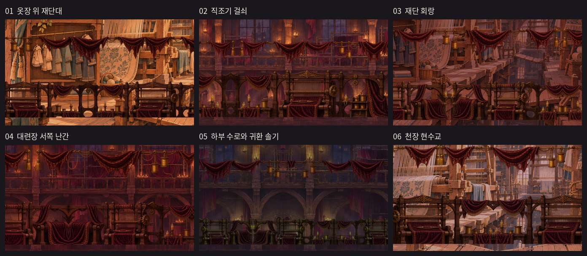

# 레벨 패스 2단계 · 벨벳 재단거리 01~06

**정적 검증 7,502건 통과, 실패 0건.** 기존 7,385개 검사 항목을 이름과 중복 개수까지 대조했고 누락은 0개였다. 여섯 방 모두 고정 턱 두 개를 통해 상층에 닿는다. 미하일 대련 직후에는 05 한 방에 은실 유효 사용 기회가 82회 있다. 첫 안전 귀환에 필요한 80회는 재입장, 적 재생성, 같은 솔기 재사용 없이 확보할 수 있다. [전체 검증 결과](STATIC-VALIDATION.json)

**이번 빌드의 Unity 플레이 시간은 미측정이다.** 로컬에 Unity 에디터·플레이어·C# 컴파일러가 없고, QA에 사용했던 PC 러너는 SSH 프록시 소켓 생성에서 `PermissionError [Errno 1]`로 연결이 차단됐다. 아래 점프 수치와 공급량은 정적 결과다. 이번 빌드의 9단계·feel 3종·파일럿·구역 probe 완주, 3~5분 간격, 구역 전체 25~40분, 실제 첫 방문 난이도와 Game 뷰 가독성은 확인하지 못했다.

## 두 폭의 천을 오르내리는 경로

좌표는 플레이어 발 기준 월드 유닛이다. 높이 열은 하층에서 일반 점프 세 번으로 밟는 고정면의 상단이다. 카메라 열은 추적점의 x 범위와 y 범위이며, 추락선보다 발이 낮아지면 기존 재시작 처리가 작동한다.

| 방 | 첫 방문과 귀환에서 하는 일 | 고정 턱 → 턱 → 상층 | 카메라 x / y | 추락선 |
|---|---|---|---|---:|
| 01 입구 | 하층 x=8에서 옷장을 조사하고 입구 웨이브를 끝낸다. 고정 턱으로 올라 재단대 복귀점을 지나 x=28.5 상층 문으로 02에 간다. 오른쪽 기둥은 선택 경로다. | 1.25 → 2.55 → 3.85 | 0~32 / 1.5~7.5 | −8 |
| 02 직조실 | 하층 걸쇠 두 개를 열면 x=37 아래 문이 03 도착 선반으로 이어진다. 같은 x의 위 문은 조사 후 06으로 이어진다. 상층에 접촉 저장을 붙였고 중간 북 선반에 별도 적을 배치했다. | 1.30 → 2.60 → 3.90 | 0~44 / 1.5~9 | −10 |
| 03 회랑 | 서쪽 선반에서 내려와 동쪽 걸쇠를 푼다. 상층 복귀점 옆 문은 04 대련장, 하층 문은 미하일 격파 후 05로 이어진다. | 1.40 → 2.85 → 4.25 | 0~44 / 1.5~9 | −10 |
| 04 대련장 | 서쪽 상층 난간 x=4에 도착해 아래로 내려가 대련한다. 동쪽 턱으로 난간에 돌아올 수 있다. 패배 후 서쪽 복귀, 조사 후 걸쇠 타격과 탈출 판자 걷기, 보상 뒤 05 이동은 기존 스토리 행을 쓴다. | 1.35 → 2.70 → 4.05 | 0~42 / 1.5~8.5 | −10 |
| 05 귀환로 | 아래 수로를 동쪽으로 꿰매며 중갑병을 지난다. 동쪽 끝에서 고정 턱을 올라 방향을 바꾸면, 지나온 길 위로 긴 솔기 50개가 서쪽으로 이어진다. 솔기를 놓치면 아래 수로로 떨어져 다시 올라갈 수 있다. | 1.35 → 2.70 → 4.05 | 0~182 / 1.5~9 | −11 |
| 06 현수교 | 02에서 x=2 상층에 도착해 복귀점과 x=10의 04 문을 지난다. 아래로 내려가면 정예 조합과 기존 연습 장치가 있고, 동쪽 고정 턱으로 다시 올라온다. | 1.30 → 2.65 → 4.00 | 0~35 / 1.5~8.5 | −9 |

20ms 간격으로 실제 이동 속도·공중 가감속·점프·중력을 적분해 하강 중 어느 면에 먼저 착지하는지 검사했다. 세 번의 점프에 걸린 모형 시간은 방 번호순으로 **2.04 / 2.04 / 1.98 / 1.98 / 1.98 / 2.00초**다. 도보·전투·대화 시간은 제외했다. 05 상층에서는 각 솔기 양쪽의 고정 천을 지지면으로 삼아, 은실을 설치하지 않은 틈 50개도 모두 일반 점프로 건널 수 있는지 별도로 검사했다. [방 데이터](Assets/Resources/Story/representative.json) · [경로 검사](tools/validate_level_step2.py)

## 적과 걸쇠

| 방 | 편성 | 배치와 첫 방문 부담 |
|---|---|---|
| 01 | 상시 검 걸쇠 1. 입구 웨이브는 장갑 파수병 1 → 반사상 1 → 검 걸쇠 1 | 상시 걸쇠는 x=6. 기존 웨이브는 한 개체의 공격 판정이 닫힌 뒤 다음 한 개체를 활성화한다. |
| 02 | 검 걸쇠 2, 중갑병 3, 장갑 파수병 2 | 필수 걸쇠는 하층 x=6·8.4. 파일럿의 피격 관측 대상은 하층 x=9.3에 남겼다. 파수병 둘은 높이 1.35의 북 선반에서만 활성화된다. |
| 03 | 검 걸쇠 1, 중갑병 3, 반사상 2 | 걸쇠는 하층 x=29.6. 서쪽 구간에서 방어 개방형 반사상과 중갑병을 만난다. 중갑병을 4명×3마디에서 3명×4마디로 조정해 검으로 끊는 마디 수 12를 유지했다. 은실 습득 전 중갑병은 기존 일반 검격 판정을 쓴다. |
| 04 | 미하일 1, 일반 적 0 | 검격과 교차 공격 두 패턴의 단독 대련. 체력 14, 중간 기준 7을 유지했다. |
| 05 | 중갑병 8, 반사상 3 | 하층 x=83~132에 중갑병을 7유닛씩 떨어뜨렸다. 한 명에게 은실 두 번과 검격 한 번을 쓴다. 반사상은 x=143·148·153의 검사 선반에 있어 아래 수로를 그대로 지날 수 있다. |
| 06 | 일반 중갑병 2, 은실 전용 관절 4, 장갑 파수병 4, 반사상 3 | 하층 x=7의 관절과 x=8의 반사상은 활성 범위가 겹친다. 두 대응을 섞는 선택 정예전이다. 상층 지름길은 모든 적의 활성 범위 밖이다. |

방 roster의 각 개체는 고유 `placementIds` 항목을 통해 위치와 발 기준 활성 사각형을 함께 읽는다. 01의 순차 웨이브는 기존 웨이브 카탈로그를, 04의 미하일은 전용 대련 드라이버를 사용한다. [배치·활성화](Assets/Scripts/Story/RepresentativeRoomLayout.cs) · [입구 웨이브와 안내](Assets/Scripts/Story/FirstDeparture.cs)

## 솔기 감사와 첫 80회

짧은 솔기는 폭 0.9, 긴 솔기는 폭 2.2다. 은실의 허용 폭은 1단계 1.0, 2단계 4.5다. 절단 매듭은 긴 솔기의 일부로 합계에 한 번만 포함했다. 관절 열은 은실 보유 후 각 개체의 관절을 따로 겨눴을 때의 준비 횟수이며 솔기 개수와 별도다.

| 방 | 짧은 솔기 전→후 | 긴 솔기 전→후 | 솔기 합계 전→후 | 절단 매듭 전→후 | 은실 관절 전→후 |
|---|---:|---:|---:|---:|---:|
| 01 | 0→0 | 0→0 | 0→0 | 0→0 | 0→0 |
| 02 | 3→3 | 2→2 | 5→5 | 0→0 | 12→12 |
| 03 | 3→3 | 0→0 | 3→3 | 0→0 | 12→12 |
| 04 | 0→0 | 0→0 | 0→0 | 0→0 | 0→0 |
| 05 | 6→16 | 7→50 | **13→66** | 3→3 | **8→16** |
| 06 | 2→2 | 3→3 | 5→5 | 1→1 | 6→6 |
| **합계** | **14→24** | **12→55** | **26→79** | **4→4** | **38→46** |

인수 당시 05 중갑병에는 `setupHits`가 없어 런타임 기본값 1이 적용됐다. 1단계에서 서로 다른 짧은 솔기 6개와 관절 준비 8회를 모두 따로 세어도 14회여서, 05 첫 방문만으로 2단계 기준 30회에 닿지 못했다. QA 6차 기록에서도 05에서 01·02·03을 거쳐 다시 05에 들어왔다. 이번 보정은 **05 한 번의 방문으로 80회에 도달**하는 것을 기준으로 했다.

1. **1~16회**. 05 도착 바닥 x=2에서 첫 솔기 x=3.8까지는 1.8유닛이다. 바로 동쪽을 보고 Q를 누르면 사거리 2.6 안에서 첫 지지대를 안정화할 수 있다. 이후 하층 짧은 솔기를 4.8유닛 간격으로 지난다.
2. **17~32회**. 중갑병 8명의 관절을 각각 두 번 준비한다. 일곱 번째 중갑병의 두 번째 준비가 30회째여서 2단계가 열린다. 각 마디를 끊는 기본 검격은 은실 횟수에서 제외했다.
3. **33~80회**. 상층에 긴 솔기를 설치하고, 그 시전으로 생긴 발판에 직접 착지하면 1회다. 서로 다른 발판 48개면 80회에 도달한다. 공급은 50개여서 두 곳의 여유가 있다. 80회째 임시 발판에서 인접한 고정 천으로 옮겨 기존 안전 귀환 호출을 받는다.

방 전체의 정적 기회는 **16 + 16 + 50 = 82회**다. 같은 시전의 중복 효과, 2단계에서 설치만 한 솔기, 재생성된 적은 계산에서 제외했다. 새 `seamRuns`는 각 줄의 시작 x·y, 수량, 가로 간격을 지정한다. 05의 물리 경계도 함께 넓혔다. 두 필드를 생략한 방은 기존 산식과 경계를 사용한다. [성장 판정](Assets/Scripts/Skills/StitchSurface2D.cs) · [키 입력 귀환 경로](Assets/Scripts/AutoTest/VelvetTraversal.cs)

## 조사 후 지름길

조사 전에는 02 x=37의 하층 문만 걸쇠 개방 후 03 도착 선반으로 이어진다. 상층에서 같은 x에 서서 F를 눌러도 06에 들어갈 수 없다. `investigation_complete`가 저장되면 02 상층 문이 06의 `velvet_upper_safe`로 이어지고, 06 x=10에서 F를 누르면 04 서쪽 난간 `mikhail_arena_west`에 도착한다. 04→06과 06→02도 같은 조사 조건과 도착 층을 사용한다.

02의 문을 통과한 뒤 중간 방에서 필요한 수평 변위는 **03 경유 30.5유닛 이상**(x=6.5→37), **06 경유 8유닛**(x=2→10)이다. 06은 같은 높이로 통과한다. 이번 빌드의 두 경로에 걸린 실제 시간은 미측정이다.

## 구역 probe와 복귀점 간격

기존 `-autotest`에서 슬롯 1이 시계탑 진입까지 9단계를 끝내면 별도 결과 `report.json → velvetDistrict`가 시작된다. 같은 격리 폴더의 빈 슬롯 2를 메뉴에서 골라 새 게임을 진행한다. 파일럿 비교 주행·R 재시도는 슬롯 1에서 끝난다. 슬롯 2는 실제 대련과 80회 귀환, 작업실 조사, 승강기 탑승을 거친 뒤 벨벳을 다시 선택한다. 위치·조사 플래그·사용 횟수를 주입하는 단계는 없다. 18초 무진행 판정은 두 주행에 공통이다. [구역 probe](Assets/Scripts/AutoTest/VelvetDistrictProbe.cs) · [실행·보고](Assets/Scripts/AutoTest/AutoTestDriver.cs)

| 접촉 구간 | 끝 복귀점 | 실제 간격 / 목표 |
|---|---|---|
| 01 진입 → 01 재단대 | `wardrobe_cutting_rail` | 미측정 / 180~300초 |
| 01 재단대 → 02 직조실 상층 | `loom_balcony_floor` | 미측정 / 180~300초 |
| 02 상층 잠긴 문 확인 → 03 보스 문 앞 | `gallery_balcony_floor` | 미측정 / 180~300초 |
| 03 보스 문 앞 → 04 대련장 입구 | `mikhail_arena_west` | 미측정 / 180~300초. 같은 보스 재도전 구간의 양 끝 |
| 04 대련장 입구 → 05 수로 회차점 | `waterway_splice_floor` | 미측정 / 180~300초 |
| 05 회차점 → 조사 후 06 현수교 | `suspension_clasp_floor` | 미측정 / 180~300초. 거점 체류 시간은 별도 기록 |

`contacts[]`는 고정면 콜라이더에 실제로 서고 표시 x의 0.8 이내에 들어와, 저장 성공 상태에서 해당 v4 바닥 영수증을 확인한 시점에 기록한다. 04처럼 도착 문이 이미 바닥을 저장한 경우에도 물리 접촉을 기다린다. 접촉마다 중간 JSON을 발행한다.

- `fromEntrySeconds`는 01 최초 진입 후 누적 실시간, `roomEntryToContactSeconds`는 해당 방 진입 후 접촉까지의 시간, `segmentSeconds`는 직전 접촉 이후 실시간이다. `feetX/Y`와 출발·도착 바닥도 기록한다.
- `outsideVelvetSeconds`는 해당 구간의 거점·메뉴 시간이다. 이를 뺀 `districtSeconds`로 `targetBand`를 판정한다. 180초 미만은 `below-target`, 180~300초는 `within-target`, 300초 초과는 `above-target`이다. 간격이 목표에서 벗어나도 실제 관측값을 남긴다.
- 지름길은 첫 방문 상층 F 거부, 조사 후 02→06→04 방 순서와 두 도착면을 확인한다. `outboundViaGallerySeconds`와 `shortcutSeconds`는 각각 02 문 입력부터 04 도착까지다. 05에서는 첫 유효 표적, 고유 시전 수, 짧은 솔기·관절·상층 지지 접촉 횟수를 따로 남긴다. 80회 전에 05를 떠나거나 필수 접촉을 놓치면 구역 probe는 실패한다.

## 배경과 검증 범위

01은 옷가지와 금빛 천이 보이는 재단 작업장, 04는 붉은 현수 장식과 대칭 아치, 05는 청회색 염색장 하부 아치, 06은 높은 직조기와 자줏빛 실내를 사용한다. 기존 02·03과 함께 각 방마다 원경·중경·근경을 별도 세트로 연결했다. 어느 세트에도 `stage1-far/mid`가 없다. 아래는 각 상층 위치에서 실제 자산의 UV·색조·타일·시차를 적용한 배경 합성이다. 원경 원화 두 장과 소품 띠를 공유하므로 직조기·천 장식과 좌우 반전 타일이 반복된다. 긴 05에서 보이는 반복 정도, 캐릭터·착지면·HUD를 겹친 가독성은 실기 미확인이다. [배경 세트](Assets/Resources/GameArt/backgrounds/room-sets.json)

2단계 전용 검사는 **98건**, 그중 변조 검출은 **60/60건**이다. 도착 층 교체, 조사 조건 삭제, 고정 턱·솔기 지지면 제거, 두 관절의 사거리 중첩, 접촉 없는 측정 성공 등을 검사한다. 스토리 56방·321행의 조건과 보상을 포함한 행 해시는 `b86303ec3a3ec31e51e41ea1d5399b750fc206086203beb775c74f42c4637203`을 유지했다. 기존 v4 바닥 ID를 전부 보존했고 저장 스키마 변경은 없다. 이전 PC QA 6차는 9단계·feel 3종·파일럿을 통과했고 당시 파일럿의 01→03 접촉 관측값은 30.52초였다. 이번 구역 probe의 여섯 구간에는 새 PC 실행에서 얻은 값만 들어간다.

푸시 매니페스트는 작업공간 루트의 `push-paths-level-step2.bin`이다. 이전 푸시와 같은 Unity 저장소 루트(`unity/RewindNotary`) 상대 경로를 사용한다. 통합 검증은 전체 작업공간에서 `python3 tools/validate_gamedev.py`로 실행하며, 변경한 검증 도구와 기준 자료는 Unity 프로젝트의 `tools/`에도 같은 내용으로 수록했다.
