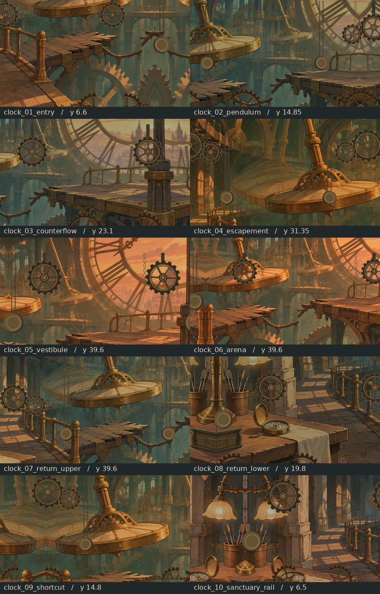

# 레벨 패스 3단계 · 시계탑

시계탑 10개 방에 황동 종축을 중심으로 오르고 내려오는 경로를 적용했다. 초입에서 율리우스 대련장 입구까지 문을 지날 때마다 높이가 이어진다. 대련 뒤에는 축 안쪽으로 돌아 내려오며 처음 보는 진자 정거장만 84개를 만난다. 해금 기준은 2단계 30회, 3단계 80회다. **정적 검증은 7,760건 통과, 실패 0건**이다. 기존 7,516개 검사명을 중복 개수까지 대조했고 누락은 0개였다. [정적 결과](STATIC-VALIDATION.json)

**이번 빌드의 Unity 실측은 없다.** 로컬에서 Unity 에디터·플레이어와 C# 컴파일러를 찾지 못했다. 기존 PC 러너는 SSH 프록시 소켓 생성 시 `PermissionError [Errno 1]`로 연결이 차단됐다. 이번 변경의 C# 컴파일, 9단계·feel 3종·벨벳 파일럿·두 구역 probe 완주, 접촉 간격, 승강기 소요 시간, 프레임률과 Game 뷰 가독성은 미확인이다. 기존 PC 8차 실행은 Unity 6000.6.9f1에서 9/9단계, feel 3/3, 파일럿, 벨벳 복귀점 6개를 통과했다. 해당 실행은 이번 변경 전의 기준이다.

## 방별 동선

좌표는 월드 유닛, 높이는 고정면 상단 기준이다. 중심축은 x=22다. 카메라의 가로 추적 범위는 전 방 x=0~46이며, 세로 범위와 추락 재시작선은 아래와 같다. 각 방의 금빛 복귀점은 고정면에 놓았다. [방 데이터](Assets/Resources/Story/clock.json)

| 방 | 첫 방문·귀환 동선 | 카메라 y | 추락선 |
|---|---|---:|---:|
| 01 초입 | x=12 작업대와 x=16 걸쇠를 지나 태엽을 감는다. x=22~35의 경사로가 바닥에서 높이 3.30의 동쪽 통로로 이어진다. 바깥쪽에서 방향을 돌려 6.60의 문자판 보행로에 닿는다. 승강기와 02행 문이 이 층에 있다. | 1~10.10 | −8 |
| 02 진자실 | 6.60에서 동쪽 받침으로 올라 긴 서쪽 진자 통로를 건넌 뒤 14.85의 축머리로 돌아온다. 아래쪽 진자판은 3.6초 주기로 우상향 왕복한다. | 7.60~18.35 | −1.40 |
| 03 역류교 | 14.85에서 서쪽 역지턱을 밟고 동쪽 바깥 테두리까지 올라간 뒤 23.10의 교두로 되감아 들어온다. 아래 역류교는 4.4초 주기로 좌상향 왕복한다. x=43.7 바깥 톱니의 벽 박차기는 선택 경로다. | 15.85~26.60 | 6.85 |
| 04 탈진기 | 23.10에서 동쪽 팔레트, 탈진륜, 서쪽 잠금면 순으로 올라간다. 31.35의 승강기층에서 05로 전진하거나 개통 뒤 01로 내려간다. | 24.10~34.85 | 15.10 |
| 05 대기실 | 31.35의 무전투 대기실이다. 서쪽 경사로와 동쪽 종 테두리가 이어진다. 37.90의 문 장치를 직접 조작하고 39.60의 관부에서 대련장에 들어간다. | 32.35~43.10 | 23.35 |
| 06 대련장 | 39.60의 난간에 도착해 36.30의 원형 바닥으로 내려가 율리우스와 싸운다. 조사 후 분기의 셔터는 6초 주기 중 4초 열리며, 해당 시간에 복귀 판자 접촉이 필요하다. 양쪽 대련 분기의 마지막 행은 07 상단에 도착한다. 재충전 시련의 기존 저층 아레나도 카메라·추락 범위에 포함했다. | 1.50~44.75 | −8 |
| 07 상부 귀환로 | 39.60에서 동쪽으로 출발한다. 6개 정거장이 놓인 긴 층 7개를 번갈아 돌고, 양 끝의 짧은 톱니턱을 거쳐 19.80까지 내려간다. 첫 정거장에서 왕복한 뒤 같은 층의 고정면을 건너야 첫 귀환 행이 끝난다. | 20.80~43.10 | 11.80 |
| 08 하부 귀환로 | 같은 19.80에서 이번에는 동쪽 끝 x=39에 도착해 서쪽으로 출발한다. 층마다 정거장 7개, 긴 층은 6개다. 층간 높이차 3.96을 중간 턱에서 나눠 0까지 내려간다. | 1~23.30 | −8 |
| 09 연계 지름길 | 8.25의 하층에서 정거장에 대응하고 바로 옆 솔기를 꿰맨다. 사슬 받침과 동쪽 스프로킷을 지나 14.80의 회차로에서 05·10으로 갈라진다. 기존 조사·은실·진자 진입 조건을 유지했다. | 9.25~18.30 | 0.25 |
| 10 구호소 난간 | 하층 재회 판자와 구호소 문에서 출발해 동쪽 레일 받침, 서쪽 훈련 테두리, 6.50의 난간까지 돌며 오른다. 상층에서 승강장이나 초입으로 돌아간다. | 1~10.00 | −8 |

고정 계단은 인접한 두 면이 겹치는 곳에서 일반 점프로 올라가며, 내려갈 때는 아래 면이 위 면 밖으로 돌출된 쪽으로 걸어 나간다. 20ms 간격으로 점프 초속 12와 중력 29.43을 적용해 하강 중 처음 만나는 상단을 확인했다. 01~10의 고정면 등반에서 공중 시간의 합은 각각 **2.48 / 3.14 / 3.10 / 3.10 / 3.12 / 1.86 / 7.44 / 5.60 / 2.48 / 2.52초**다. 이 계산은 전투·걷기·대화를 제외한다. 01·05 경사로 양 끝의 바닥 접속과 02·03 이동판의 궤도 범위도 별도로 검사했다. 실제 승차 중 이동감이나 벽 박차기 단축 시간은 측정하지 못했다. [경로 검사](tools/validate_level_step3.py) · [경사면과 접촉](Assets/Scripts/Story/StoryTerrain.cs) · [이동판](Assets/Scripts/Story/StoryMovingSurface.cs)

## 적과 장치

표의 마디는 각 개체를 검으로 마무리해야 하는 횟수다. 31개 일반 적·걸쇠 모두 고유 배치 ID, 좌표, 발 기준 활성 범위, 마디 수, 준비 기술, 준비 횟수와 기술 전용 여부를 대조했다. 진자 정거장 87개는 별도 생성되며 각 정거장에 진자 준비 1회·마디 1·기술 전용 설정을 전달한다. 05는 보스 전 완충 구간, 06은 단독 대련장이다. [생성 코드](Assets/Scripts/Story/RepresentativeRoomLayout.cs) · [정거장 판정](Assets/Scripts/Story/DistrictRoomLayout.cs)

| 방 | 구성 | 배치와 대응 |
|---|---|---|
| 01 | 검 걸쇠 1×1마디 | 작업대 동쪽 x=16에서 일반 검으로 연다. |
| 02 | 검 걸쇠 2×1, 장갑 파수병 3×3 | 걸쇠는 x=38·12의 서로 다른 층, 파수병은 x=23·17·13에 나눴다. |
| 03 | 검 걸쇠 2×1, 장갑 파수병 1×3, 반사상 2×4 | 하부 역지턱과 바깥 테두리에 걸쇠를 두고 높이 19.55·23.10에서 방어 개방형 반사상을 만난다. |
| 04 | 검 걸쇠 2×1, 반사상 1×2, 장갑 파수병 1×3 | 동쪽 x=35에서 서쪽 x=6까지 차례로 층을 바꾸며 잠금면을 통과한다. |
| 05 | 일반 적 0 | 시련종·문 장치와 보스 입장 동선에 집중한다. |
| 06 | 율리우스 1, 일반 적 0 | 대련 체력 14, 조사 후 중간 전환 기준 7을 유지했다. |
| 07 | 진자 중갑병 2×3, 진자 걸쇠 2×1 | x=41·2의 돌아가는 턱에 중갑병, x=3의 턱과 x=43의 하단에 걸쇠를 뒀다. |
| 08 | 진자 걸쇠 1×2, 진자 중갑병 3×2 | x=42의 동쪽 턱에 두 마디 걸쇠를 두고, 중갑병을 서쪽 중간 턱 두 곳과 맨 아래 동쪽 끝에 나눴다. |
| 09 | 진자 중갑병 2×3, 반사상 1×3, 검 걸쇠 2×1 | **정예 조합.** 높이 13.15의 같은 스프로킷에 중갑병 x=33과 반사상 x=31을 뒀다. 활성 범위가 겹쳐 진자 준비와 방어 개방을 함께 처리한다. |
| 10 | 진자 중갑병 3×1 | x=29·19·9의 서로 다른 층에 둔다. 각자 진자 준비를 세 번 마쳐야 한 마디를 끊을 수 있다. |

## 첫 방문 성장 자원 감사

정거장은 서로 다른 표적에서 상태 변화를 일으킨 첫 발동만 센다. 한 발동의 돌진과 복귀는 한 번이다. 준비 기회는 적의 유한한 마디에 필요한 진자 발동 수다. 오른쪽 열은 별도 기술의 기회이며 진자 합계에서 제외했다. 검 마디에는 대련 체력을 더하지 않았다.

| 방 | 진자 정거장 전→후 | 진자 적·걸쇠 준비 전→후 | 진자 합계 전→후 | 기본검 마디 | 은실 솔기 |
|---|---:|---:|---:|---:|---:|
| 01 | 0→0 | 0→0 | 0→0 | 1 | 0 |
| 02 | 0→0 | 0→0 | 0→0 | 11 | 0 |
| 03 | 0→0 | 0→0 | 0→0 | 13 | 0 |
| 04 | 0→0 | 0→0 | 0→0 | 7 | 0 |
| 05 | 0→0 | 0→0 | 0→0 | 0 | 0 |
| 06 | 0→0 | 0→0 | 0→0 | 대련 체력 14 별도 | 0 |
| 07 | 4→42 | 8→8 | 12→50 | 8 | 0 |
| 08 | 4→42 | 8→8 | 12→50 | 8 | 0 |
| **첫 귀환 07+08** | **8→84** | **16→16** | **24→100** | **16** | **0** |
| 09 · 연계 선택로 | 3→3 | 6→6 | 9→9 | 11 | 3 |
| 10 · 조사 후 재회 | 0→0 | 9→9 | 9→9 | 3 | 0 |

보정 전에는 첫 귀환의 24회를 모두 써도 30회까지 6회, 80회까지 56회 부족했다. 보정 후에는 적의 준비를 감사에서 전부 빼도 **다른 정거장 84개**가 남는다. 07의 30번째 정거장에서 2단계 기준에 닿고, 07의 42개와 08의 38개로 3단계 기준에 닿는다. 07 교전에 쓴 준비가 있으면 08에서 더 일찍 도달한다. 09·10의 기회, 재입장, 적 재생성, 정거장 재무장은 이 하한에서 제외했다. 100회는 배치 공급량이며 실제 주행에서 발생한 유효 사용 수는 미측정이다. [기술 기준](Assets/Resources/Skills/catalog.json) · [보정 전후 검사](tools/validate_level_step3.py)

율리우스 격파 뒤 두 대사 분기 모두 07 고정면의 x=5.5, 높이 39.60에 도착한다. 첫 시계판은 같은 면 x=8에 있어 **수평 거리 2.5**가 1단계 돌진 사거리 3.2 안에 든다. 돌진을 되돌리는 두 번째 입력은 같은 발동 ID로 확인한다. 나머지 정거장도 각각의 고정 발 구름 위치에서 돌진 범위가 인접 정거장이나 활성 적과 겹치지 않는지 검사했다. [진자 돌진과 안전 복귀](Assets/Scripts/Skills/PendulumRewindSkill.cs)

## 승강기와 구역 probe

01의 높이 6.60, x=20 승강기와 04의 높이 31.35, x=21 승강기를 양방향 문으로 연결했다. 양쪽 모두 `clock_04_cleared`와 `investigation_complete`가 있어야 한다. 문 앞 층에서 조사 입력을 받으면 반대쪽의 지정된 고정 바닥에 도착한다. 입구에서 04까지의 세 번의 문 이동이 한 번으로 줄어든다. 이전 세이브의 방·바닥 ID와 v4 저장 형식을 유지했다. [문 조건과 선택](Assets/Scripts/Story/RepresentativeRoomLayout.cs)

`report.json`의 `clockDistrict`는 기존 9단계와 슬롯 2 벨벳 구역 주행이 끝난 뒤 시작한다. 슬롯 3에서 실제 이동·일반 점프·검·패링·기술·조사 입력을 사용한다. 접촉 순서는 **01 → 02 → 03 → 04 → 05 → 06 → 07 → 08 → 10 → 09**다. 10은 첫 양도와 거점 조사 뒤의 율리우스 재회다. 09는 승강기 왕복 뒤 같은 슬롯으로 벨벳에서 은실을 얻고 돌아와야 들어갈 수 있다.

- `contacts`는 고정 발판과의 실제 콜라이더 접촉, 표시와 발의 x 차이 0.8 이하, 저장 성공, 해당 바닥 영수증을 확인한다. 방·바닥·발 좌표, 방 진입 후 경과, 이전 접촉 후 전체 경과와 시계탑 안팎의 시간, 최초 진입 후 누계를 쓴다. 180~300초 목표 범위도 각 구간에 기록한다.
- 초행 01에서 닫힌 승강기에 F를 누른다. 04 교전을 끝내고 조사 전인 상태에서도 반대쪽 F가 거부되는지 확인한다. 조사 뒤에는 `liftRooms`에 01→04→01을 기록하고 두 고정 바닥에서 각각 착지를 확인한다. `outboundSeconds`는 초행 양쪽 승강기 사이의 전투 포함 시간, `liftSeconds`와 `returnLiftSeconds`는 실제 문 입력부터 방 전환까지의 시간이다.
- 07 첫 정거장의 `valid_use`와 같은 발동의 복귀, 07 정거장 42곳, 07에서 30회·08에서 80회 도달, 3단계 획득을 요구한다. 같은 정거장에 두 번 적립되거나 주행 중 재시도가 발생하면 실패한다. 종료 때 디스크의 슬롯 3을 다시 읽어 숙련도, 은실, 조사·교전 플래그와 09의 복귀점 영수증을 확인한다. 기존 슬롯 1의 최종 저장 검사와 18초 무진행 실패 조건도 계속 적용한다. [시계탑 probe](Assets/Scripts/AutoTest/ClockDistrictProbe.cs) · [입력 주행](Assets/Scripts/AutoTest/ClockTraversal.cs) · [종료 판정](Assets/Scripts/AutoTest/AutoTestRuntime.cs)

## 배경과 검증 한계

열 방 각각 별도 3층 세트를 쓴다. 황혼과 먼 탑이 보이는 문자판·진자실 원화를 원경에, 추·탈진륜을 중경에, 황동 톱니 윤곽을 근경에 배치했다. 가로 시차 계수는 0.11 / 0.35 / 0.72다. 시계탑 세트는 같은 원화 한 장과 중·근경용 투명 도안 한 장을 공유한다. 방마다 자르기, 색조, 도안 선택, 반복 간격과 시작 위치가 다르다. 큰 진자와 문자판의 형태는 여러 방에서 되풀이되며, 좌우 반전 타일의 반복이 보인다. 계단·승강기에는 별도 황동 판재를, 진자 정거장에는 시계판 그림을 썼다. 일반 전투 개체는 기존 공통 실루엣을 쓴다. [배경 세트](Assets/Resources/GameArt/backgrounds/room-sets.json)

아래는 x=22, 각 방 복귀점 높이에서 Unity의 UV·시차·색조 배치를 따라 합성한 배경이다. 캐릭터·충돌체·HUD가 겹친 실제 플레이 화면과 이동 중 시인성은 미측정이다.

통합 검증은 작업공간 루트에서 `python3 -B tools/validate_gamedev.py`로 실행했다. 시계탑 전용 변조 **130/130건**을 검출했다. 별도 파일 사본에서도 04 승강기의 추가 조건 삭제, 10 중갑병 준비 횟수 누락, 07 정거장 중복 배치, 경사로 높이 변조, probe의 실제 발판 접촉 검사 제거를 각각 주입해 해당 검사가 실패하는 것을 확인했다. 전체 방 수는 56개이며, 조건·보상까지 포함한 321행의 SHA-256은 기존 값 `b86303ec3a3ec31e51e41ea1d5399b750fc206086203beb775c74f42c4637203`과 일치했다. 시계탑 42행의 원본 JSON 행 구간도 바이트 단위로 일치했다. [행 해시 검사](tools/validate_level_step1.py) · [정적 결과](STATIC-VALIDATION.json)

푸시 매니페스트 `push-paths-level-step3.bin`에는 Unity 저장소 루트 기준 상대 경로 38개가 들어 있다. 모든 대상 파일의 존재, 검증 도구 사본의 바이트 일치, 중복 경로 0개, 마지막 NUL, 매니페스트 자체 제외를 확인했다.
