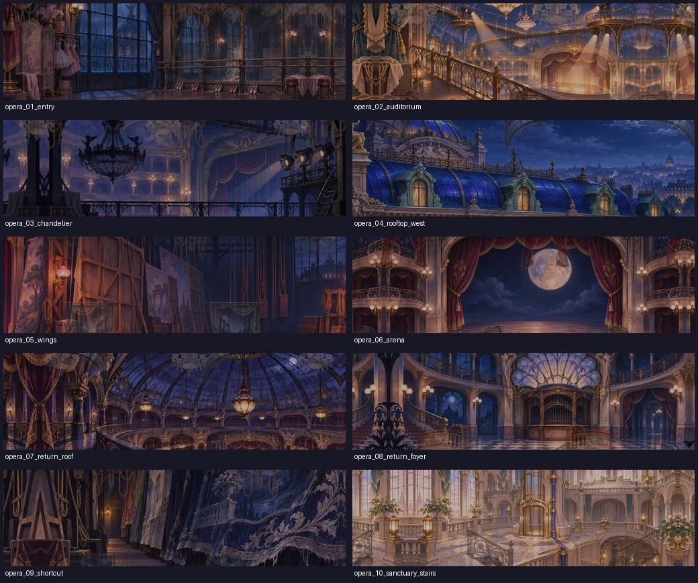

# 레벨 패스 4단계 · 유리 오페라 극장

발레리아의 열 방을 연습실에서 객석으로, 객석에서 무대 뒤 조명 통로와 지붕으로 오가는 경로로 연결했다. 대련 직후에는 발밑에서 왈츠를 쓰면 첫 등이 켜진다. 첫 귀환에는 서로 다른 정거장 84개가 있어 적을 반복 상대하지 않고도 07에서 30회, 08에서 80회에 닿는다. 조사 후에는 무대 뒤에서 객석으로 바로 내려와 문 이동이 3회에서 1회로 줄어든다. [방 데이터](Assets/Resources/Story/opera.json)

**정적 검증 8,529건 통과, 실패 0건.** 직전 7,875개 검사명을 중복 횟수까지 대조해 누락 0건을 확인했다. 오페라 원본 42행과 거점 연결 구간은 바이트 단위로 보존했다. 조건·보상을 포함한 본편 321행 해시도 일치했다. 오페라 행 구간의 SHA-256은 `012d89903878b736a38cd584e4c4af72325d399373019460a5fba2bf65ea977e`다. 추가한 데이터는 방의 바닥·좌표·문·광원·전투 배치에 속한다. [정적 결과](STATIC-VALIDATION.json) · [오페라 검사](tools/validate_level_step4.py)

작업공간 루트에서 `python3 -B tools/validate_gamedev.py --output unity/RewindNotary/STATIC-VALIDATION.json`을 실행했다. 별도 메모리 사본에서 실제 폭 대신 작성 폭 읽기, 닫힌 문 판정 누락, 중복 발동 허용, 슬롯 번호 오독을 각각 주입해 네 검사가 실패하는 것을 확인했다. 인접 정거장을 한 발동 범위에 겹친 경우와 조사 조건을 지운 경우도 각각 검출했다.

**이번 변경의 Unity 실측은 미완료다.** 작업 환경에서 Unity 에디터·플레이어와 C# 컴파일러를 찾지 못했다. 기존 PC 러너에 연결했으나 SSH 프록시가 소켓을 열 때 `PermissionError [Errno 1]`로 차단됐다. 아래 시간은 20ms 간격의 이동 재생값이다. 슬롯 4의 실제 접촉 간격, 콜라이더 폭, 숙련도, 지름길 시간, Game 뷰 및 프레임률은 이번 빌드의 실행 결과가 필요하다. 품질 기준의 구역 25~40분과 복귀점 간 3~5분도 미판정이다. 15차 PC 실행은 이전 빌드에서 시계탑 10/10 접촉과 슬롯 3 판독까지 통과했다. [직전 PC 결과](../../testresults/run15/report.json) · [품질 기준](../../31-quality-standard.md)

## 방과 배경

좌표 단위는 월드 유닛이다. 카메라의 가로 추적 범위는 전 방 x=0~46이다. 표의 높이는 발이 닿는 면의 상단, 카메라 범위는 추적점의 y다. 방마다 접촉 저장용 고정면을 하나씩 뒀다.

| 방 | 공간과 이동 | 배경 원경 | 카메라 y | 추락선 |
|---|---|---|---:|---:|
| 01 연습실 | 높이 0의 구두 선반에서 바와 드레스서클을 거쳐 5.4의 객석 문으로 오른다. | 거울에 비친 연습 바와 젖은 창 | 1~10.2 | −7 |
| 02 객석 | 5.4의 평객석에서 서쪽 박스와 중앙 발코니를 지나 10.8의 조명 통로로 올라간다. 무대 뒤 낙하구는 아래층에 닿는다. | 기존 극장 컨셉의 금빛 다층 객석 | 6.4~15.6 | −1.6 |
| 03 샹들리에 | 10.8의 서쪽 둑에서 12.6의 발코니로 오른다. 샹들리에를 건너 동쪽 받침을 밟으면 16.2의 조명 작업층에 닿는다. | 샹들리에 실루엣과 건너편 투광기 | 11.8~21 | 3.8 |
| 04 서쪽 지붕 | 16.2의 홈통에서 도머와 용마루를 거쳐 21.6의 유리 아치에 닿는다. x=26의 통풍구에서 뛰면 중간 도머를 건너뛸 수 있다. | 청색 유리 지붕 바깥과 라피스 야경 | 17.2~26.4 | 9.2 |
| 05 무대 뒤 | 21.6의 하역문에서 장치교와 대기층을 지나 16.2의 큐 데스크로 내려간다. 시련종과 무대 문, 조사 후 낙하구가 다른 위치에 있다. | 뒤집어 세운 장면판, 로프와 균형추 | 17.2~26.4 | 9.2 |
| 06 대련 무대 | 16.2의 박스석에서 12.6의 무대로 내려가 발레리아와 대련한다. 조사 후 분기에는 안전 착지대와 루카의 승강판을 사용한다. 재충전 시련의 낮은 바닥도 카메라에 포함했다. | 달 그림막과 열린 자주색 프로시니엄 | 1~21 | −7 |
| 07 귀환 지붕 | 대련 뒤 16.2에서 왈츠로 등을 켠다. 지붕 안쪽 긴 층 여섯 곳을 번갈아 돌며 36.2까지 오른다. 마지막 등을 켜고 차광 중 문을 조사하면 로비로 넘어간다. | 유리 돔 안쪽의 방사형 골조 | 17.2~41 | 9.2 |
| 08 귀환 로비 | 36.2의 맨 위 회랑에서 출발해 반대편 짧은 계단을 번갈아 밟으며 16.2까지 내려온다. 층마다 네 번째 등에서 실제 투사체가 떨어진다. | 조개 부채꼴 스테인드글라스와 매표소 | 17.2~41 | 9.2 |
| 09 재봉 통로 | 5.4의 천 밑단에서 은실로 솔기를 잇고 왈츠로 인접한 등을 켠다. 균형추를 지나 10.8의 장치문으로 오른다. | 은실 자수가 풀린 장면막 사이 통로 | 6.4~15.6 | −1.6 |
| 10 구호소 계단 | 아래층에서 발레리아와 재회하고 승강판을 탄다. 층계참·창가·5.4의 상층 계단이 승강장과 초입으로 이어진다. | 기존 대법정 컨셉의 밝은 석조 난간 | 1~10.2 | −7 |

03에서 고정면끼리만 연결되는 방향별 경로는 서쪽과 동쪽을 합쳐 8개다. 나머지 12개 방향은 가운데 움직이는 판을 건너야 연결된다. 전 구역의 고정면 경로 306개를 일반 점프와 걸어 내려가기만으로 검증했다. 04의 통풍구를 쓰지 않은 경로도 여기에 포함된다. 07·08은 긴 층 사이 4유닛을 중간 턱에서 2유닛씩 나눈다. [고정면 이동 재생](tools/validate_fixed_surface_route.py) · [스테이지 장치](Assets/Scripts/Story/OperaFixtures.cs)

샹들리에 판의 폭은 13, 수평 왕복 거리는 0.55, 왕복 주기는 4.8초다. 스포트라이트는 1초 예고와 1.8초 조사를 거쳐 3.2초간 차광된다. 조사 중에는 높이 6의 차단 판정이 통로를 막는다. 차광 중 판을 밟고 반대편 고정 발코니로 이동할 수 있다. 6초 주기를 300개 출발 시점으로 나눠 양방향 **600/600회**를 재생했다. 발코니 사이 15유닛을 건너는 시간은 대기 포함 **2.32~5.12초**였다. 동쪽까지 닿지 않도록 판 폭을 6으로 줄인 대조군은 횡단에 실패했다. [차광과 탑승 검사](tools/validate_level_step4.py)

### 배경 구성과 재사용

열 방에 서로 다른 원경 PNG 10장을 연결했다. 02와 10은 기존 컨셉, 나머지 8장은 오페라용 신규 원화다. 객석에서 무대를 바라보는 장면과 무대에서 객석 쪽을 등지는 대련 장면, 지붕 바깥 야경과 지붕 안쪽 골조를 각각 다른 그림으로 제작했다. 중·근경은 투명 소품 시트의 커튼·샹들리에·도르래·유리 아치·박스석·발등·장면막·난간 8종을 방별로 골라 쓴다. 가로 시차는 0.11 / 0.34 / 0.72다. 아래 합성은 각 복귀점 근처의 배경만 보여 준다. [세트와 자르기](Assets/Resources/GameArt/backgrounds/room-sets.json)

소품이 타일로 다시 나타나는 곳이 있고, 발판 한가운데의 금속 상감, 등기구와 일반 적 실루엣은 공용이다. 10의 석재와 금장에는 대법정 원화가 그대로 드러난다. 03의 실제 이동판과 조명 원뿔, 04의 통풍구, 07·08의 작동 등은 게임 오브젝트로 배경 위에 그린다.

신규 원화 제작 기록

내장 ImageGen으로 8개 원경과 4열×2행 소품 시트를 만들었다. 저장 경로는 `Assets/Resources/GameArt/backgrounds/opera-*.png`다. 원경 프롬프트의 공통 조건은 심야 벨 에포크 오페라, 횡스크롤 게임용 가로 환경화, 읽히는 건축 윤곽, 낮은 대비의 남색 그림자, 인물·문자·HUD 제외였다. 각 원경에 지정한 피사체는 다음과 같다.

| 파일 | 피사체 프롬프트 |
|---|---|
| opera-studio | empty dance rehearsal studio with a scuffed parquet floor, a row of slippers and barre facing tall patinated backstage mirrors, tall blue rain-streaked windows |
| opera-lantern | looking across the dark suspended service galleries of a Belle Époque opera, one great crystal chandelier in silhouette and a bank of antique stage spotlights with rotating shutters on the other side |
| opera-glass | high exterior on the cobalt blue glass mansard roof of an elaborate opera house, delicately wrought iron ribs, copper verdigris dormers and distant lamp-lit city skyline, pale moonlight |
| opera-wings | backstage fly loft, slung canvas scenery flats showing their wooden backs, ropes and counterweights, rose-amber practical lamps and charcoal-blue shadows |
| opera-arena | a frontal performance stage laid out for a solo waltz, enormous painted moon hanging over a deep navy cyclorama, rich garnet curtains parted, ivory footlights |
| opera-oculus | inside the high glazed roof lantern and cupola of an opera, fine radial fan of glass ribs opening onto a midnight sky, overhead lamp chains, tiny stage far below |
| opera-foyer | an oval public foyer, abandoned ticket kiosk beneath a fan of shell-shaped stained glass, checkerboard marble floor |
| opera-seam | narrow backstage service passage looking along the hanging hems of enormous embroidered scenery cloths, one frayed navy silk drop edged in silver thread, tiny golden lamp at a distant door |

소품 시트에는 위쪽에 커튼·샹들리에·도르래·유리 아치, 아래쪽에 객석 난간·발등·찢어진 장면막·계단 난간을 각각 독립된 셀에 놓도록 지정했다. 생성본의 밝은 바탕을 제거해 투명 채널을 정리하고, 실제 등과 샹들리에의 셀을 따로 추출했다.

## 적과 성장 자원

표에서 마디는 검으로 끊어야 하는 횟수다. 왈츠 준비가 붙은 표적은 해당 마디에 기술 효과가 먼저 들어가야 한다. 일반 적과 걸쇠 30개에는 각자의 발 좌표와 활성 범위를 지정했다.

| 방 | 구성 | 배치 의도 |
|---|---|---|
| 01 | 검 걸쇠 1×1마디 | 선반을 조사한 뒤 한 층 위의 걸쇠를 친다. |
| 02 | 검 걸쇠 2×1, 장갑 파수병 3×3 | 평객석·서쪽 박스·상층 출입구에 흩어져 있다. |
| 03 | 검 걸쇠 2×1, 반사상 2×4, 장갑 파수병 1×3 | 양쪽 발코니의 걸쇠와 동쪽 상층의 방어 개방형 반사상이 횡단 전후를 나눈다. |
| 04 | 검 걸쇠 1×1, 장갑 파수병 1×2, 반사상 1×4 | 높이 19.8의 용마루에서 파수병 x=26과 반사상 x=23의 활성 범위가 겹친다. |
| 05 | 일반 적 0 | 대련 준비와 하강구를 살펴보는 무전투 구간이다. |
| 06 | 발레리아 단독 | 대련 체력 14, 조사 후 중간 전환 체력 3을 유지했다. |
| 07 | 왈츠 중갑병 2×3, 왈츠 걸쇠 2×1 | 동쪽과 서쪽의 짧은 턱에서 마디마다 왈츠 한 번을 준비한다. |
| 08 | 왈츠 반사상 1×2, 왈츠 중갑병 3×2 | 높이가 다른 서쪽·동쪽 턱 네 곳을 맡는다. 투사체 정거장은 긴 회랑에 있다. |
| 09 | 왈츠 중갑병 2×3, 방어 개방형 반사상 1×3, 검 걸쇠 2×1 | **정예 혼합전.** 높이 9.0의 같은 균형추에 중갑병 x=27과 반사상 x=29가 함께 있다. 왈츠 준비와 방어 개방의 대응이 겹친다. |
| 10 | 왈츠 중갑병 3×1 | 세 층에 한 기씩 배치했다. 각자 한 마디를 끊기 전에 왈츠 세 번이 필요하다. |

### 첫 귀환 정거장 감사

발레리아의 두 대련 분기 모두 07의 x=9, 높이 16.2에 도착한다. 첫 등은 같은 x에서 발보다 2.4유닛 위에 있다. **이동 거리 0**에서 위+Q로 첫 등을 켜고 그 옆의 고정면을 건너면 기존 대본의 첫 귀환 행동이 끝난다. [대련 분기와 정거장](Assets/Resources/Story/opera.json) · [왈츠 접촉 판정](Assets/Scripts/Skills/CurtainCallWaltzSkill.cs)

| 첫 방문 구간 | 기존 정거장 | 변경 후 정거장 | 적·걸쇠 준비 | 변경 후 왈츠 기회 |
|---|---:|---:|---:|---:|
| 01~06 | 0 | 0 | 0 | 0 |
| 07 지붕 | 4 | 등 42 | 8 | 50 |
| 08 로비 | 3 | 등 36 + 투사체 6 | 8 | 50 |
| **첫 귀환 합계** | **7** | **84** | **16** | **100** |
| 09 연계 선택로 | 3 | 등 3 | 6 | 9 |
| 10 조사 후 재회 | 0 | 0 | 9 | 9 |

보정 전에는 첫 귀환의 23회를 전부 써도 30회에 7회, 80회에 57회 모자랐다. 보정 후에는 적 준비, 방 재입장, 정거장 재생성, 09·10을 모두 제외하고도 80회를 넘는다. 아래 번호는 방 안에서 만나는 순서이며 누계에는 정거장만 포함했다.

| 방과 층 진행 방향 | 각 층의 정거장 번호 | 층을 마칠 때의 누계 |
|---|---|---|
| 07 · 16.2에서 36.2로 상승 | 1~7 / 8~14 / 15~21 / 22~28 / 29~35 / 36~42 | 7 / 14 / 21 / 28 / **35** / 42 |
| 08 · 36.2에서 16.2로 하강 | 1~7 / 8~14 / 15~21 / 22~28 / 29~35 / 36~42 | 49 / 56 / 63 / 70 / 77 / **84** |

**30회**는 07의 30번째 등(x=13.5, 높이 32.2), **80회**는 08의 38번째 등(x=27, 높이 16.2)에서 성립한다. 각 층의 정거장 간격은 4.5다. 08의 4·11·18·25·32·39번째 정거장에서는 하향 투사체를 쳐낸다. 세 단계의 왈츠 범위와 상승 속도로 각 위치의 발동을 재생해 매번 해당 정거장 하나만 닿는지 검사했다. 적 준비를 함께 적립하면 더 일찍 도달한다. 100회는 공급량이며 슬롯 4 실주행의 적립량은 미측정이다. [숙련 기준](Assets/Resources/Skills/catalog.json) · [정거장별 재생](tools/validate_level_step4.py)

## 귀환 지름길과 실측 판정

05의 x=28, 높이 16.2에 있는 하강구는 `investigation_complete`가 있어야 열린다. 02의 x=20, 높이 5.4에 착지한다. 조사 전 두 지점 사이의 구역 내 최단 경로는 **05→04→03→02**, 조사 후에는 **05→02**다. 문 이동이 **3회에서 1회로 2회 감소**한다. 두 지점의 높이 차이는 10.8이다. 02에서 05로 다시 올라가는 선택로는 기존 은실·왈츠·조사 조건을 거쳐 09로 이어진다.

같은 출발점과 도착점 사이에서 점프·보행·샹들리에 대기를 재생한 기존 길의 시간은 05 **7.95초**, 04 **7.47초**, 03 **7.53초**, 02 **5.28초**, 합계 **28.23초**다. 문 로딩·전투·대사는 뺐다. 직행문은 출발점에서 조사하면 지정 도착점으로 연결된다. 실제 초 단위 단축량은 슬롯 4가 양쪽을 완주할 때 산출한다. [경로 비교](tools/validate_level_step4.py)

Unity의 기존 `AutoTestRunner.Run`은 본편·feel·파일럿·벨벳·시계탑 다음에 오페라를 실행한다. `report.json`의 `operaDistrict`가 아래 증거를 남긴다. [구역 probe](Assets/Scripts/AutoTest/OperaDistrictProbe.cs) · [입력 이동](Assets/Scripts/AutoTest/OperaTraversal.cs) · [종료 판정](Assets/Scripts/AutoTest/AutoTestRuntime.cs)

- 슬롯 4에서 **01→02→03→04→05→06→07→08→10→09** 순으로 실제 고정 발판 접촉, 표식과 발의 x 거리 0.8 이하, 저장 성공과 해당 바닥 영수증을 확인한다. 접촉 좌표와 스크린샷, 구역 안팎의 경과시간, 180~300초 대역을 기록한다. 10에서 재회한 뒤 같은 슬롯에서 은실을 얻어 09에 들어간다.
- 03은 차광 중 중앙에서 실제 샹들리에 콜라이더에 닿고 동쪽 고정 발코니에 착지해야 한다. 귀환에서는 첫 왈츠의 표적 ID, 서로 다른 발동 ID 및 정거장 ID, 07의 42곳, 07의 30회와 08의 80회를 검사한다.
- 05에서 조사 전 F 입력이 거부되는지 확인한다. 조사 후에는 같은 낙하구에서 출발해 04·03을 거친 시간과 직행문을 쓴 시간을 각각 재며, 두 번 모두 같은 02 고정 바닥에 도착해야 한다. 직행 시간이 더 길거나 같으면 실패한다.
- 방 최초 진입 때 Unity 2D 물리 변환을 동기화하고 **작성 지형 55개**의 실제 `Collider2D.bounds.size.x`와 JSON 사각형 너비를 대조한다. 고정면과 움직이는 샹들리에를 모두 포함하며 차이가 **0.005유닛 초과**면 실패한다. 타일 렌더러는 자식에 두고 루트의 박스 치수·배율을 독립시켰다.
- 네 번째 슬롯은 autotest 임시 저장소에서만 활성화된다. 슬롯 1~3 JSON의 SHA-256을 슬롯 4 진입 직후와 종료 직전에 비교한다. 마지막에는 슬롯 4를 디스크에서 읽어 발레리아 승리·조사·은실·왈츠 3단계와 80회 이상·09 바닥 영수증을 확인한다. 18초 위치·상태 정체, 120초 구역 무진전, 구역당 1,500초 한도와 재시도 실패 판정을 그대로 적용한다.

## 변경 파일과 매니페스트

경로는 Unity 저장소 루트 기준이다. 묶어 표기한 신규 리소스 15개와 신규 C# 파일 3개에는 각각 같은 이름의 `.meta`도 포함된다.

| 경로 | 내용 |
|---|---|
| `Assets/Resources/Story/opera.json`, `Assets/Resources/GameArt/backgrounds/room-sets.json` | 방·적·정거장·문과 열 방의 배경 세트 |
| `Assets/Resources/GameArt/backgrounds/opera-{studio,auditorium,lantern,glass,wings,arena,oculus,foyer,seam,stairs}.png` | 방별 원경 10장 |
| 같은 폴더의 `opera-{props,lamp,chandelier,inlay,beam}.png` | 투명 시차 소품, 등, 샹들리에, 지형 상감, 조명 원뿔 |
| `Assets/Scripts/Story/{RepresentativeScript,RepresentativeRoomLayout,RepresentativeArea,DistrictRoomLayout,StoryTerrain,OperaFixtures}.cs` | 층·문·착지·지형·조명·통풍구·승강판과 정거장 연결. OperaFixtures 신규 |
| `Assets/Scripts/Skills/PracticeLamp2D.cs` | 왈츠 등 전용 그림과 점등 상태 |
| `Assets/Scripts/Progression/{CoreRecord,SkillSaveStore}.cs`, `Assets/Scripts/Shell/GameShell.cs` | autotest 슬롯 4 선택·생성·검증 |
| `Assets/Scripts/AutoTest/{AutoTestDriver,AutoTestReport,AutoTestRuntime,PlaytestObservations,OperaDistrictProbe,OperaTraversal}.cs`, `Assets/Editor/AutoTestRunner.cs` | 실제 입력·접촉·폭·슬롯 비교 및 실패 기록. OperaDistrictProbe와 OperaTraversal 신규 |
| `tools/{validate_level_step4,validate_gamedev,validate_area_links,validate_fixed_surface_route,validate_level_step1,validate_level_step3,story_link_baseline}.py`, `tools/level-step4-extensions.json` | 새 재생 검사, 변형 검출, 과거 검사와 원본 해시 대조 |
| `LEVEL-STEP4-REPORT.md`, `LEVEL-STEP4-BACKGROUNDS.jpg`, `STATIC-VALIDATION.json` | 리포트, 배경 합성, 통합 검사 결과 |

작업공간 루트의 [푸시 매니페스트](../../push-paths-level-step4.bin)는 **63개 경로, 2,945바이트**다. 레포 상대 경로만 NUL로 구분했고 마지막 바이트도 NUL이다. 자체 경로와 중복 경로는 없다.
