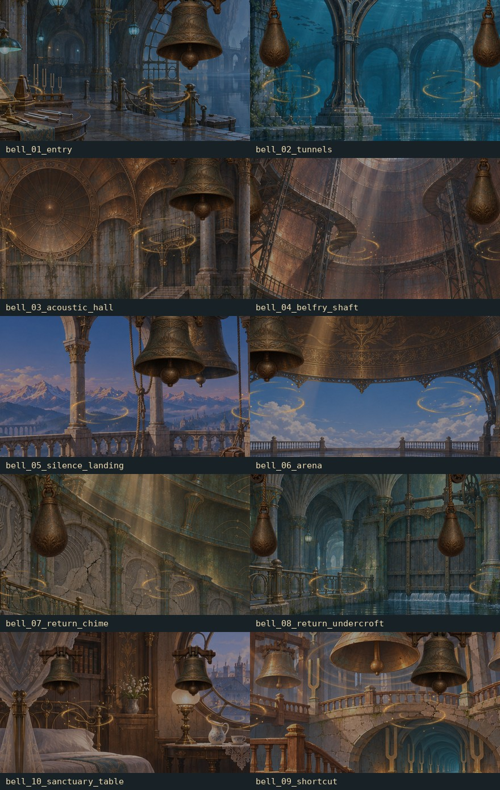

# 레벨 패스 5단계 · 청동 대종루

소리굽쇠 지하도에서 수면 높이 0까지 내려간 뒤, 종 갱도와 타종실을 거쳐 높이 58의 종 안쪽에서 가브리엘과 대련한다. 승리 직후 도착하는 회랑에는 첫 공명 단조로 깨지는 석판이 있다. 두 귀환방을 한 번씩 내려가며 만나는 단조 정거장은 **84곳**이다. 조사 후 열리는 하강구는 타종실 대기실에서 지하도로 돌아가는 문 이동을 **3회에서 1회**로 줄인다. [방 데이터](Assets/Resources/Story/bell.json)

**정적 검증 9,329건 통과, 실패 0건.** 직전 8,557개 검사명을 중복 횟수까지 대조해 누락 0건을 확인했다. 작업공간 루트에서 `python3 -B tools/validate_gamedev.py --output unity/RewindNotary/STATIC-VALIDATION.json`으로 재현할 수 있다. 상세 수치는 결과 파일의 `level_step5_metrics`에 있다. [통합 결과](STATIC-VALIDATION.json) · [대종루 검사](tools/validate_level_step5.py)

**슬롯 5의 Unity 실주행은 미측정이다.** 이 작업공간에는 Unity 에디터·플레이어나 C# 컴파일러가 없고, 기존 PC 러너로의 SSH 연결은 프록시 소켓 생성 단계에서 `PermissionError [Errno 1] Operation not permitted`로 차단됐다. 아래 이동·회피 시간은 20ms 고정 틱 재생값이다. 지정된 25~40분 플레이 분량, 복귀점 간 3~5분, 프레임률, Game 뷰, 디스크 저장과 실물 콜라이더는 이번 빌드의 실행 판정이 남았다. 직전 PC run20은 오페라까지의 결과다. [직전 실행](../../testresults/run20/report.json) · [품질 기준](../../31-quality-standard.md)

## 공간과 복귀점

표의 높이는 발판 상단이고, 복귀점 좌표는 실제 접촉 저장 표식의 x와 바닥 y다. 카메라 x 범위는 06의 0~60을 제외하면 0~46이다. 06은 상층 타종실에서 재충전 연습 대련의 동쪽 끝까지 보여 준다.

| 방 | 주요 진행 높이 | 지형 수 | 접촉 복귀점 (x, y) | 카메라 y | 추락선 |
|---|---|---:|---:|---:|---:|
| 01 하차장 | 16 → 악보대 14 → 배수턱 12 → 수문 10 | 4 | (5, 16) | 11~21.2 | 3 |
| 02 소리굽쇠 지하도 | 10 → 0. 여섯 영구 계단과 걸쇠로 깨우는 징검판 두 개 | 8 | (16, 6) | 1~15.2 | −7 |
| 03 음파 고리 수로 | 0 → 8. 수면 위 공명판을 밟아 제동 걸쇠가 있는 단으로 상승 | 5 | (7, 0) | 1~13.2 | −7 |
| 04 종 갱도 | 8 → 42. 축 주위의 발판 18개를 오르며 세 높이에서 파동을 만남 | 18 | (19, 26) | 9~47.2 | 1 |
| 05 타종실 대기실 | 42 → 54. 우유 선반·망치 받침·상부 문턱을 지남 | 7 | (12, 52) | 43~59.2 | 35 |
| 06 종 안쪽 대련장 | 54 → 피신턱 56 → 대련 바닥 58 | 3 | (11, 56) | 55~63.2 | 47 |
| 07 하강 공명 회랑 | 58 → 31. 석판을 깨고 회랑 여섯 층을 지그재그로 하강 | 16 | (5.5, 58) | 32~63.2 | 24 |
| 08 지하 귀환 수로 | 31 → 4. 공명 기둥 여섯 줄을 따라 수차까지 하강 | 16 | (5.9, 31) | 5~36.2 | −3 |
| 10 구호소 종루 휴게실 | 10 → 탁자 12 → 창가 14 → 승강장 16 | 4 | (4, 10) | 11~21.2 | 3 |
| 09 균열 대종 통로 | 8 → 봉합턱 10 → 정예전 12 → 음파 다리 14 | 4 | (4, 8) | 9~19.2 | 1 |

04 한 방의 고저차는 **34유닛**, 07·08의 연속 하강은 **54유닛**이다. 07·08의 회랑은 층간 5.4유닛을 두 개의 짧은 반환턱에서 1.8유닛씩 나눈다. 구역 전체 85개 지형이 열렸을 때 서로 다른 두 면 사이의 **방향별 경로 946개**를 일반 점프와 보행으로 확인했다. 모든 저장 바닥에서 발을 0.05유닛 띄워 떨어뜨렸을 때 해당 면에 먼저 닿았고, 각 방의 서쪽 빈 열 x=−3.4에서 떨어뜨렸을 때 해당 추락선을 통과했다. 구버전 저장에서 참조하는 바닥 ID도 유지했다. [고정면 재생](tools/validate_fixed_surface_route.py) · [접촉 및 저장](Assets/Scripts/Story/StoryTerrain.cs)

02에서는 기본검 걸쇠를 하나 끊을 때마다 징검판 하나가 실체를 얻는다. 걸쇠를 0·1·2개 끊은 상태별로 각각 6·7·8개 발판 전체를 왕복하고 다음 걸쇠 아래에 설 수 있다. 03의 공명판은 먼지 고리가 0.8초간 벌어진 뒤 4초 주기 중 0.8~3.2초에 열리고, 올라선 동안 지지를 유지한다. 두 걸쇠를 끊으면 고정된다. 200개 출발 위상에서 일반 점프로 공명판에 닿았고 대기를 포함한 최댓값은 2.72초였다. 두 방의 조건부 발판은 저장면에서 제외했다. [징검판과 파동](Assets/Scripts/Story/BellWaves.cs)

## 방별 배경 세트

열 방에 서로 다른 원경 PNG를 한 장씩 연결했다. 09의 거대 종·수문·교량은 기존 대종루 컨셉을 사용했다. 나머지 아홉 원경은 ImageGen으로 제작한 환경화를 방별로 잘라 넣었다. 중경은 청동종과 매달린 추 두 소품을 재사용하고, 근경은 먼지의 끊어진 동심원을 반복한다. 가로 시차는 원경 0.12, 중경 0.36, 근경 0.72다. [세트 데이터](Assets/Resources/GameArt/backgrounds/room-sets.json)

| 방 | 원경에서 읽히는 장소 | 중경 |
|---|---|---|
| 01 | 악보가 펼쳐진 관리실과 창밖 선착장의 수면 반사 | 책상 위로 드리운 청동종 |
| 02 | 물에 잠긴 아케이드와 소리굽쇠 모양의 교각 | 수로 구동추 |
| 03 | 청동 원판이 벽 전체를 차지하는 음향 홀 | 수면 위 작은 타종구 |
| 04 | 채광구를 향해 감겨 올라가는 갱도 안쪽 비계 | 깊이를 가르는 종추 |
| 05 | 상층 아치 너머의 하늘과 산맥 | 문턱 위 청동종 |
| 06 | 하늘을 배경으로 벌어지는 대종 안쪽의 새긴 테두리 | 대련 바닥 위의 종 |
| 07 | 아래쪽에서 햇빛을 받는 부조벽과 경사진 공명 회랑 | 반환 계단의 추 |
| 08 | 수차가 놓인 수문과 물에 비친 돌 천장 | 수차 조절추 |
| 10 | 우유 주전자와 탁자, 도시가 보이는 원창 | 탁자 위쪽의 소형 종 |
| 09 | 기존 원화의 균열 교량, 거대 청동종과 지하 수문 | 봉합 지점 위의 종 |

그림은 복귀점에서 카메라 높이와 시차식을 적용한 **배경 합성**이다. 실제 움직이는 추·위험 윤곽·적은 게임에서 그 위에 표시한다. 긴 층에서는 같은 소품과 먼지 고리가 다시 보인다. 청동 발판 상감은 시계탑 타일을 다른 색으로 쓰고, 일반 적은 기존 실루엣 시트를 공유한다.

## 적 배치와 성장 감사

마디는 해당 표적에서 검으로 끊어야 하는 횟수다. 01~05는 선행 기술 없이 통과할 수 있다. 06의 조사 전 대련 체력 14와 조사 후 중단 체력 7을 보존했다.

| 방 | 구성 | 전투 위치와 대응 |
|---|---|---|
| 01 | 검 걸쇠 1×1마디 | 악보대 아래 배수턱에서 첫 문을 연다. |
| 02 | 걸쇠 2×1, 장갑 파수병 2×3, 반사상 1×3 | 첫 걸쇠가 연 징검판에서 두 번째 걸쇠를 치고 수로 바닥의 반사상을 상대한다. |
| 03 | 걸쇠 2×1, 장갑 파수병 2×3, 반사상 1×3, 중갑병 1×2 | 공명판과 상단 제동층에 흩어져 있다. 기술 획득 전의 중갑병은 기존 노출 장갑 규칙으로 기본검을 받는다. |
| 04 | 걸쇠 1×1, 장갑 파수병 1×3, 반사상 1×3 | 파수병은 높이 20, 반사상은 높이 32에서 갱도 파동과 함께 대응하게 된다. |
| 05 | 일반 적 0 | 두 높이에서 파동과 피신턱에 집중한다. |
| 06 | 가브리엘 단독 | 반경이 낮은 종격과 착지 위치를 지정하는 종격을 번갈아 쓴다. |
| 07 | 단조 중갑병 2×3, 단조 걸쇠 2×1 | 짧은 반환턱에서 마디마다 단조 준비 후 기본검으로 절단한다. |
| 08 | 단조 반사상 1×2, 단조 중갑병 3×2 | 공명 기둥 사이 네 반환턱을 지킨다. |
| 10 | 단조 중갑병 2×1, 단조 타격 전용 중갑병 1×3 | 앞의 두 기는 각각 단조 세 번 뒤 기본검 한 번, 마지막 적은 단조 세 번을 받는다. |
| 09 | 단조 중갑병 2×3, 일반 걸쇠 2×1, 반사상 1×3 | **정예 혼합전.** 높이 12의 같은 모루에서 x=27 중갑병과 x=29 반사상의 활성 범위가 겹친다. 단조 준비와 방어 개방을 함께 처리한다. |

### 첫 귀환 정거장

가브리엘 대련의 두 결말 모두 07의 **(5.5, 58)**에 도착한다. 첫 석판 중심은 **(6.6, 58.55)**다. 전방 수평 간격은 1.1유닛이다. 제자리에서 짧게 뛰어 석판을 향해 아래+Q를 누르면 첫 유효 사용이 기록되고 2.8유닛짜리 격벽의 충돌체가 사라진다. 바닥에 선 채 아래+Q를 누르면 현행 입력 규칙상 다른 기술이 선택된다. [입력 판정](Assets/Scripts/Shell/GameInput.cs) · [실제 단조 타격](Assets/Scripts/Skills/ResonanceForgeSkill.cs)

| 첫 방문 | 정거장 | 전투 준비 | 유효 기회 |
|---|---:|---:|---:|
| 기존 07·08 | 4 + 4 | 8 + 8 | 24 |
| 07 하강 공명 회랑 | 균열 석판·소리굽쇠 42 | 8 | 50 |
| 08 지하 귀환 수로 | 공명 기둥 42 | 8 | 50 |
| **변경 후 첫 귀환** | **84** | **16** | **100** |
| 09·10 선택 경로 | 봉합 대종 4 | 6 + 9 | 19 |

기존 공급량은 30회에 6회, 80회에 56회 모자랐다. 아래 번호는 각 방에서 처음 만나는 순서다. 정거장 하나마다 별도 표적 ID와 새 발동이 필요하다. 한 번 파쇄한 표적은 같은 방문 중 추가 적립이 없다.

| 층 | 방 안의 정거장 번호 | 진행 | 07 바닥 y / 정거장 누계 | 08 바닥 y / 첫 귀환 정거장 누계 |
|---|---|---|---|---|
| 첫째 | 1~7 | → | 58 / 7 | 31 / 49 |
| 둘째 | 8~14 | ← | 52.6 / 14 | 25.6 / 56 |
| 셋째 | 15~21 | → | 47.2 / 21 | 20.2 / 63 |
| 넷째 | 22~28 | ← | 41.8 / 28 | 14.8 / 70 |
| 다섯째 | 29~35 | → | 36.4 / 35 | 9.4 / 77 |
| 여섯째 | 36~42 | ← | 31 / 42 | 4 / 84 |

**정거장만 합산한 30회**는 07의 30번(x=12.2, y=36.4), **80회**는 08의 38번(x=27.8, y=4)이다. 반환턱 적 준비까지 순서대로 적립하는 probe 동선의 예상 지점은 07의 23번, 08의 24번이다. 실제 도달 방은 슬롯 5의 성장 이벤트에서 읽는다. 세 단계 각각에서 84개 표적을 개별 대조했다. 1·2단계는 짧은 점프의 초기 세 물리 틱, 3단계는 착지 폭발 반경 3.5를 사용했다. 첫 격벽과 두 번째 정거장의 간격은 5.6으로 잡아 3단계에서도 두 표적이 함께 깨지지 않게 했다. [정거장별 범위 검사](tools/validate_level_step5.py)

## 무음 파동과 종격

04~06의 여섯 파동은 해당 높이에서 플레이어가 접근할 때 시작한다. 추가 올라갔다 떨어지면서 아래 발판의 양끝·위·아래 윤곽과 위턱의 흰 착지선이 먼저 보인다. **1.35초** 뒤 발판 왼쪽에서 파면이 출발하고, 속도는 초당 9유닛, 위협 높이는 0.8유닛이다. 피해 판정은 전 프레임과 현재 프레임 사이를 쓸어 검사한다. 음량이나 오디오 콜백은 이 시계에 관여하지 않는다.

| 예고 위치 | 위턱 x | 위험층 → 피신층 y | 가장 불리한 시작의 첫 피격 가능 시각 | 위턱 착지까지 | 여유 |
|---|---:|---|---:|---:|---:|
| 04 하부·중부·상부 | 13 | 8→10, 20→22, 32→34 | 2.187초 | 1.280초 | 0.907초 |
| 05 아래 아치 | 11 | 42→44 | 2.187초 | 1.280초 | 0.907초 |
| 05 망치 받침 | 29 | 48→50 | 1.520초 | 1.280초 | **0.240초** |
| 06 타종실 입구 | 11 | 54→56 | 2.187초 | 1.280초 | 0.907초 |

예고 시작을 0초로 두고 발동 범위 ±3유닛을 0.1유닛 간격으로 검사했다. 반응 0.20초, 입력·물리 반영 두 틱, 흰 선까지의 보행, 일반 점프의 착지 0.56초를 포함한다. 도달 시각은 캡슐 반지름과 파면 앞쪽 두께까지 포함한 보수적 하한이다. 예고를 0.01초로 줄이고 파속을 올린 대조군은 실패했다. 슬롯 5에서는 각 방 첫 파동이 지나가는 순간 지정한 위턱에 실제로 서 있어야 통과한다. [파동 판정](Assets/Scripts/Story/BellWaves.cs) · [무음 재생](tools/validate_level_step5.py)

본편 대련은 Trials의 가브리엘 종격 두 항목을 순환한다. 첫 종격은 **1.2초 예고**, 반경 3.2, 높이 0.75다. 타격 0.2초 전 일반 점프를 시작한 재생에서 0.15초의 타격 구간 내내 발은 1.75유닛 이상이었다. 두 번째는 **1.4초 예고** 때 레아의 x를 고정하고 폭 4, 높이 2.8의 착지 윤곽을 그린다. 반응 시간을 넣은 보행 재생에서 0.60초에 범위를 벗어났다. 두 공격 모두 예고에 사용한 사각형을 타격에도 쓴다. 조사 후 대련의 정지 손짓과 합의된 배지는 기존 장면에 연결돼 있다. [종격 실행기](Assets/Scripts/Trials/BenefactorTrialOpponent.cs)

## 조사 후 귀환과 구역 probe

하강구 출발점은 05 망치 받침 **(27, 50)**, 착지점은 02 소리굽쇠 선반 **(16, 8)**이다. 조사 전 구역 내 최단 경로는 **05→04→03→02**, 조사 후에는 **05→02**다. `investigation_complete`가 있어야 직행문이 열린다. 같은 두 표식 사이에서 기존 길을 재생한 방별 이동 시간은 4.95 + 19.73 + 6.24 + 5.78 = **36.70초**였다. 직행은 출발 표식에서 조사한 후 지정 바닥에 도착한다. 비교 재생에서 문 로딩·교전·대기 시간을 제외했다. 실제 단축 시간은 probe의 두 시계로 측정한다.

`AutoTestRunner.Run`은 오페라 뒤에 `BellDistrict`를 실행한다. 결과는 `report.json`의 `bellDistrict`에 기록된다. [구역 probe](Assets/Scripts/AutoTest/BellDistrictProbe.cs) · [입력 이동](Assets/Scripts/AutoTest/BellTraversal.cs) · [저장 검증](Assets/Scripts/AutoTest/AutoTestRuntime.cs)

- 임시 저장소의 **슬롯 5**에서 01→02→03→04→05→06→07→08→10→09 순서로 실제 고정면 접촉, 표식과 발의 x 거리 0.8 이하, 저장 성공 및 해당 바닥 영수증을 확인한다. 접촉 좌표, 스크린샷, 방 진입·구역 내외 시간과 180~300초 대역을 남긴다.
- 첫 단조 표적, 서로 다른 발동·표적 ID, 07의 42곳, 07의 30회와 08의 80회, 무음 피신턱 세 곳을 기록한다. 05의 닫힌 하강구에서 실제 조사 입력이 거절돼야 한다. 조사 후 같은 두 바닥에서 일반 길과 직행 길을 각각 재며 직행 시간이 더 짧아야 한다.
- Unity 물리 변환 동기화 후 오페라 **55개**와 대종루 **85개**, 합계 **140개 작성 지형**의 실제 콜라이더 너비를 JSON과 대조한다. 허용 오차는 0.005유닛이다. 고정 사각형은 왼쪽·아래쪽 좌표와 높이도 비교한다. 시계탑의 1.6배 문제를 막기 위해 타일 렌더러는 자식에, 명시한 크기의 `BoxCollider2D`는 배율 1인 루트에 두고 자동 타일 결합을 껐다. 닫힌 징검판도 사각형을 유지하며 접촉만 트리거로 전환한다. [지형 생성](Assets/Scripts/Story/RepresentativeRoomLayout.cs) · [공유 실측 코드](Assets/Scripts/AutoTest/OperaDistrictProbe.cs)
- 슬롯 5 생성 전과 종료 시 슬롯 1~4의 파일 SHA-256을 비교한다. 끝에서 슬롯 5를 디스크로부터 읽어 가브리엘 승리, 조사 완료, 은실 획득, 단조 3단계·80회 이상과 09 바닥 영수증을 확인한다. 일반 플레이는 세 슬롯을 사용한다. 무진전 18초, 구역 정체 120초, 구역당 1,500초 및 재시도 실패 조건을 유지했다.

## 변경 파일과 매니페스트

스토리 문장·대사·행 데이터와 거점 연결은 보존했다. `bell.json`에서 42개 행과 거점 연결을 포함한 원본 바이트 구간의 SHA-256은 `0f682e1a677e05443978652bc3bb4ea36e555c4f544c97540329770bb99b0312`다. 장면 연결에 추가한 내용은 방 안의 문 접근 범위·목적 바닥, 접촉 저장 표식, 기믹·단조 정거장·적 배치다. 본편 321행의 조건·행동·보상 해시도 재검사했다.

| Unity 저장소 상대 경로 | 변경 내용 |
|---|---|
| `Assets/Resources/Story/bell.json`, `Assets/Resources/GameArt/backgrounds/room-sets.json` | 열 방과 방별 3층 배경 |
| 같은 배경 폴더의 `bell-{quay,aqueduct,resonator,shaft,canopy,mouth,reliefs,waterwheel,fracture,sanctuary}.png` | 각 방의 원경 |
| 같은 폴더의 `bell-{bronze,weight,dust,fork,slab,pillar}.png` | 시차 소품, 움직이는 추와 파쇄 표적. PNG 16장 각각의 `.meta` 포함 |
| `Assets/Scripts/Story/{BellWaves,DistrictRoomLayout,RepresentativeArea,RepresentativeRoomLayout,RepresentativeScript,StoryTerrain}.cs` | 파동·징검판, 대련 진입, 지형·복귀·문 연결 |
| `Assets/Scripts/Trials/BenefactorTrialOpponent.cs`, `Assets/Scripts/Skills/ResonanceTarget2D.cs` | 본편 종격 윤곽과 타격, 연습 대련 높이, 파쇄 표적 |
| `Assets/Scripts/Progression/CoreRecord.cs`, `Assets/Scripts/Shell/GameShell.cs` | 테스트 슬롯 5의 검증과 선택 화면 |
| `Assets/Scripts/AutoTest/{BellDistrictProbe,BellTraversal,ClockTraversal,OperaDistrictProbe,PlaytestObservations,AutoTestDriver,AutoTestReport,AutoTestRuntime}.cs`, `Assets/Editor/AutoTestRunner.cs` | 실제 입력, 열린 발판 경로 갱신, 지형 대조, 슬롯 격리 및 실패 기록. 신규 C# 세 파일 각각의 `.meta` 포함 |
| `tools/{validate_level_step5,validate_level_step4,validate_level_step3,validate_level_step1,validate_fixed_surface_route,validate_area_links,validate_gamedev,story_link_baseline}.py`, `tools/level-step5-extensions.json` | 정적 재생, 과거 공급·해시와 현행 구현 대조 |
| `LEVEL-STEP5-REPORT.md`, `LEVEL-STEP5-BACKGROUNDS.jpg`, `STATIC-VALIDATION.json` | 리포트, 복귀점 배경 합성, 검증 결과 |

작업공간 루트의 [푸시 매니페스트](../../push-paths-level-step5.bin)는 **68개 경로, 3,154바이트**다. 레포 상대 경로를 NUL로 구분했고 마지막 바이트도 NUL이다. 중복과 매니페스트 자체 경로는 없다.
