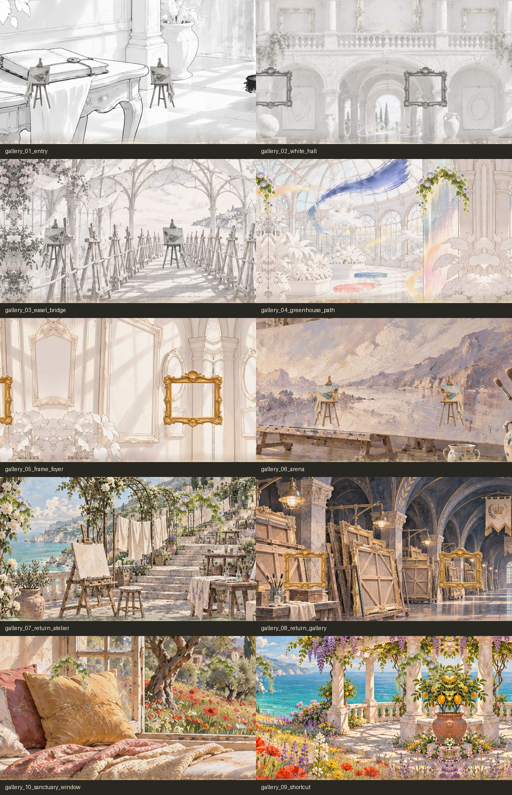

# 레벨 패스 6단계 · 하얀 캔버스 화랑

02에서 레아는 위 액자길과 아래 조각길 중 하나를 고른다. 두 길은 같은 착지실과 03행 문으로 이어진다. 이리나와 대련한 뒤에는 07의 첫 영구 석판에서 곧바로 물감 발판을 그릴 수 있다. 첫 귀환의 화폭 조각 유효 사용 기회는 **25회에서 96회**로 늘었다. 그중 **80회는 서로 다른 빈틈에 새 획을 그려 실제로 밟는 기회**다. 조사 후 열린 액자문은 05에서 02로 돌아가는 문 이동을 **3회에서 1회**로 줄인다. [화랑 방 데이터](Assets/Resources/Story/gallery.json)

**정적 검증 10,082건 통과, 실패 0건.** 직전 9,395개 검사명을 중복 횟수까지 대조해 누락 0건을 확인했다. 아래 점프·귀환 시간은 게임의 이동 상수와 20ms 물리 틱을 사용한 재생값이다. [통합 검증 결과의 `level_step6_metrics`](STATIC-VALIDATION.json) · [화랑 검증 코드](tools/validate_level_step6.py)

**슬롯 6의 Unity 실주행은 미측정이다.** 로컬에 Unity 에디터·플레이어와 C# 컴파일러가 없고, 기존 PC 러너에 접속할 때 SSH 프록시가 소켓 생성 단계에서 `PermissionError [Errno 1] Operation not permitted`로 종료됐다. 직전 PC run22는 오페라 55개와 대종루 85개 지형, 대종루 복귀점 10개와 슬롯 5 판독을 통과했다. 이번 빌드의 컴파일, 화랑 Game 뷰, 이동·전투 시간과 프레임률, 접촉·디스크 저장 결과는 남아 있다. 품질 기준의 구역 25~40분과 복귀점 간 3~5분도 실기 판정 전이다. [run22 원본](../../testresults/run22/report.json) · [품질 기준](../../31-quality-standard.md)

## 공간과 복귀점

좌표는 각 방의 로컬 좌표다. 복귀점의 y는 발이 닿는 면의 높이다. 열 방 모두 서쪽 경계 안의 x=−3.4에서 낙하하면 해당 방의 추락선을 통과한다. 이전 저장과 스토리 행이 사용하는 바닥 ID는 모두 유지했다.

| 방 | 공간과 주요 이동 | 작성 지형 | 접촉 복귀점 (x, y) | 카메라 x / y | 추락선 y |
|---|---|---:|---|---|---:|
| 01 초입 화실 | 종이 마루에서 스케치북 탁자, 안료 작업대, 액자문으로 | 4 | (5, 0) | 0~46 / 1~8.4 | −7 |
| 02 백색 전시실 | 높이 4에서 갈라져 위 7.6 또는 아래 2.2를 거쳐 높이 4에 합류 | 8 | (6, 4) | 0~56 / 3.2~12.8 | −4.8 |
| 03 이젤 가교 | 삼각대와 가로대를 올라 두 걸쇠를 절단하고 캔버스 다리로 온실에 진입 | 5 | (5, 4) | 0~46 / 5~12.8 | −3 |
| 04 유리 온실 | 분수대 6에서 수로 2.4로 내려갔다 덩굴 시렁을 밟고 6으로 복귀 | 5 | (5, 6) | 0~46 / 3.4~11.2 | −4.6 |
| 05 액자 전실 | 액자 보관대와 팔레트턱을 거쳐 높이 11.4의 대련장 문으로 | 4 | (5, 6) | 0~46 / 7~16.6 | −1 |
| 06 아틀리에 대련장 | 입구 단에서 햇살 마루로 내려가 대련. 오른쪽 창턱에서 조사 후 고백 | 3 | (4.5, 2) | 0~60 / 1~7.2 | −7 |
| 07 온실 색상 회랑 | 열 칸씩 네 줄의 화단을 지그재그로 하강. 25.2 → 9 | 50 | (6.45, 25.2) | 0~99 / 10~30.4 | 2 |
| 08 하부 수장고 | 여덟 칸씩 다섯 줄의 보관 선반을 내려감. 21.6 → 0 | 53 | (6.45, 21.6) | 0~83 / 1~26.8 | −7 |
| 10 구호소 창가 | 창가 좌석, 찻상, 창틀, 승강장 사이를 일반 점프로 이동 | 4 | (5, 0) | 0~46 / 1~8.4 | −7 |
| 09 여백 절벽 | 은실로 잇는 틈과 물감으로 건너는 틈 네 쌍을 지나 끝 테라스에서 정예전 | 9 | (51, 4) | 0~66 / 5~9.2 | −3 |

### 두 관람로와 지형 판정

분기 검사는 다른 길의 발판까지 포함한 전체 충돌 배치에서 매 도약의 **첫 착지면**을 확인한다. 양쪽 모두 서쪽 걸쇠와 동쪽 착지실의 적만 처리하면 된다. 반대편 관람로에 필수 적이나 스위치가 없다. 착지실에서 `clear:wave`를 마치면 같은 동쪽 문(x=50)이 03으로 열린다. [경로 데이터](Assets/Resources/Story/gallery.json) · [클리어 판정](Assets/Scripts/Story/DistrictRoomLayout.cs)

| 선택 | 입구 이후 실제 재생 착지 (x, y) | 입구 표식에서 출구까지 이동 |
|---|---|---:|
| 위 액자길 | 액자 계단 (10.00, 5.8) → 금액자 (16.00, 7.6) → 발코니 (27.93, 6) → 착지실 (36.82, 4) | 8.49초 |
| 아래 조각길 | 석고상 (13.88, 2.2) → 받침대 (20.24, 2.2) → 조각 계단 (27.50, 3) → 착지실 (33.50, 4) | 9.14초 |

각 길의 가운데 발판을 12유닛 올린 대조군에서는 해당 경로가 실패했다. 가교를 연 상태에서는 열 방의 서로 다른 발판 사이 **방향별 5,416쌍**이 보행과 일반 점프로 연결된다. 03은 가교가 닫힌 상태에서도 서쪽에서 두 걸쇠 모두에 접근할 수 있다. 기본 경로와 귀환 경로에 벽 점프를 요구하는 면은 없다. [고정면 재생](tools/validate_fixed_surface_route.py)

**지형 대조 대상은 기존 140개 + 화랑 145개 = 285개**다. 화랑 145개에는 영구면 144개와 걸쇠로 여는 03 가교 1개가 들어간다. 가교는 접촉 저장면에서 제외했다. 물감 지지의 작성 위치 **84곳**(07·08 각 40, 09의 4)과 09의 은실 틈 4곳은 별도로 센다. 슬롯 6에서는 각 방 진입 시 배율 1인 루트의 `BoxCollider2D`와 자식 타일 렌더러를 대조한다. 상자 크기를 명시하고 `autoTiling`을 꺼서 시계탑의 1.6배 타일 배율이 판정을 늘리는 경로를 차단했다. 실제 월드 사각형의 좌·하단, 너비와 높이의 허용 오차는 0.005유닛이다. [지형 생성](Assets/Scripts/Story/RepresentativeRoomLayout.cs) · [콜라이더 실측 코드](Assets/Scripts/AutoTest/OperaDistrictProbe.cs) · [화랑 타일 대조](Assets/Scripts/AutoTest/PlaytestObservations.cs)

**물감이 사라진 뒤의 복귀**도 같은 두 좌표에서 재생했다. 07 첫 빈틈(x=8)에 획이 있으면 낙하한 발이 물감에 먼저 닿고, 획을 제거하면 추락선까지 떨어진다. 복귀점(x=6.45)에 떨어뜨린 발은 두 경우 모두 같은 석판 `atelier_0_0`에 닿는다. 기술 초기화는 생성한 획 목록만 순회하며, 저장은 이름이 있는 고정 콜라이더와 실제 접촉할 때만 성립한다. 84곳 모두에서 단계별 3가지 출발 오차(−0.10, 0, +0.10)를 적용해 지상 설치, 물감 첫 착지, 반대편 석판 복귀를 검사했다. [물감 수명과 접촉](Assets/Scripts/Skills/PaintSurface2D.cs) · [기술 초기화](Assets/Scripts/Skills/CanvasCarveSkill.cs)

## 방별 배경 세트

원경 10장에 중경의 이젤·액자·덩굴과 전경의 유화 결을 겹쳤다. 가로 시차 계수는 각각 0.12, 0.38, 0.73이다. 표의 채도는 접촉 복귀점에 카메라가 정지했을 때의 16:9 배경을 합성한 뒤 잰 평균 HSV 채도다. 방문 순서 01→08→10→09를 따라 매번 증가한다. [세트 데이터](Assets/Resources/GameArt/backgrounds/room-sets.json)

| 방 | 원경 / 중경 | 합성 채도 |
|---|---|---:|
| 01 | 순백의 종이와 스케치북 탁자 / 목탄색 이젤 | 0.4% |
| 02 | 위층 액자와 아래층 석고 좌대가 보이는 전시실 / 옅은 액자. 실제 상층에는 액자, 하층에는 석고 조각 | 2.6% |
| 03 | 나무 이젤이 바다 쪽으로 이어지는 가교 / 소형 이젤 | 5.7% |
| 04 | 기존 원화의 둥근 유리 온실과 붓 자국 / 늘어진 덩굴 | 10.1% |
| 05 | 비어 있는 큰 액자와 화분 / 금박 액자. 조사 후 귀환 액자 안에 바다 풍경이 나타남 | 14.8% |
| 06 | 바다 풍경을 그린 대형 화폭과 창가 붓통 / 대련장 이젤 | 19.3% |
| 07 | 말리는 천, 화단 테라스와 열린 바다 / 꽃덩굴 | 23.1% |
| 08 | 짙은 청색 보관실과 겹쳐 세운 그림 뒷면 / 금박 액자 | 27.0% |
| 10 | 햇살 창가의 방석과 노을빛 꽃밭 / 창 위 꽃덩굴 | 37.8% |
| 09 | 바다를 향해 열린 꽃밭과 흰 퍼걸러 / 정원 덩굴 | 39.8% |



01·04·05의 원경은 기존 화랑 원화에서 서로 다른 장면을 잘라 채색했다. 같은 원화의 붓결을 실제 물감 지지와 바닥 주변 질감에도 사용했다. 나머지 일곱 원경과 세 중경 소품은 이번에 생성한 환경화·소품 시트에서 추출했다. 영구면에는 연속된 상아색 모서리를, 물감 지지에는 붓털 끝이 갈라진 청색 획을 적용했다. 검과 획이 닿는 전시물과 밑그림은 그 자리에서 색을 얻는다. 긴 회랑에서는 같은 이젤·덩굴과 전경 질감이 반복되고 적은 기존 실루엣을 공유한다. 위 그림은 배경 세 층의 합성이며, 움직이는 레아와 지형을 포함한 Game 뷰 캡처는 남아 있다. [원화](../../assets/concept/backgrounds/gallery.png) · [밑그림과 물감 획](Assets/Scripts/Story/GalleryPaint.cs)

## 적 배치와 성장 감사

| 방 | 구성 | 배치와 역할 |
|---|---|---|
| 01 | 검 걸쇠 1×1마디 | 안료 작업대에서 첫 액자문을 연다. |
| 02 | 걸쇠 2×1, 장갑 파수병 2×3, 반사 석상 1×3 | 출발부에 첫 걸쇠, 합류부에 두 번째 걸쇠와 전투원 세 기. |
| 03 | 걸쇠 2×1, 장갑 파수병 2×3, 반사 석상 1×3, 중갑병 1×2 | 이젤의 높이 5.8과 7.6에 걸쇠를 둔다. 기술 습득 전의 중갑병은 노출 장갑 규칙으로 처리한다. |
| 04 | 걸쇠 1×1, 장갑 파수병 1×3, 반사 석상 1×3 | 꽃밭턱, 낮은 수로, 덩굴 시렁으로 분산한다. |
| 05 | 일반 적 0 | 액자문, 복귀 표식과 연습 대련 호출종을 찾는 전실. |
| 06 | 이리나 단독 | 기존 대련 패턴의 낮은 물감선과 원거리 발사를 순환한다. 체력 14와 조사 후 중단점 7을 유지한다. |
| 07 | 화폭 중갑병 2×3, 화폭 걸쇠 2×1 | 각 줄 끝에서 물감 세팅 후 기본검으로 마무리한다. |
| 08 | 화폭 반사 석상 1×2, 화폭 중갑병 3×2 | 보관층 네 곳에서 두 마디씩 처리한다. |
| 10 | 화폭 중갑병 2×1, 화폭 전용 중갑병 1×3 | 앞의 두 기는 각각 세팅 세 번 후 검 한 번, 나머지 한 기는 화폭 세 번. |
| 09 | 화폭 중갑병 2×3, 일반 걸쇠 2×1, 반사 석상 1×3 | **정예 혼합전.** 같은 테라스의 중갑병(x=46)과 석상(x=48)의 활성 구역이 겹친다. |

두 대련 결말 모두 07의 **(6.45, 25.2)**로 연결된다. 여기서 오른쪽을 보고 지상 아래+Q를 누르면 폭 2.4인 획이 x=6.8~9.2에 놓인다. 석판 사이의 빈 구간은 x=7~9다. 물감 위로 올라서야 첫 정거장이 적립되고, 반대편 영구 석판까지 가야 첫 귀환 장면이 진행된다. [대련 및 장면 연결](Assets/Resources/Story/gallery.json) · [정거장 판정](Assets/Scripts/Story/DistrictRoomLayout.cs)

| 첫 방문 | 이전 공급 | 새 물감 정거장 | 적 세팅 | 유효 기회 |
|---|---:|---:|---:|---:|
| 07 온실 색상 회랑 | 13 | 40 | 8 | 48 |
| 08 하부 수장고 | 12 | 40 | 8 | 48 |
| **첫 귀환 합계** | **25** | **80** | **16** | **96** |
| 09·10 선택 경로 | 19 | 4 | 15 | 19 |

각 번호는 별도 빈틈 하나다. 오른쪽 진행은 x=8부터 8유닛 간격이고 왼쪽 진행은 같은 열을 역순으로 지난다. 80개 위치와 지지면 높이를 통합 결과의 `firstReturnStations`에 한 곳씩 수록했다.

| 방 | 진행 순서와 바닥 높이 | 적 세팅을 제외한 첫 귀환 누계 |
|---|---|---|
| 07 | 1~10 → y=25.2 / 11~20 ← 19.8 / 21~30 → 14.4 / 31~40 ← 9 | 10 → 20 → **30** → 40 |
| 08 | 1~8 → y=21.6 / 9~16 ← 16.2 / 17~24 → 10.8 / 25~32 ← 5.4 / 33~40 → 0 | 48 → 56 → 64 → 72 → **80** |

정거장만 세면 **30회는 07의 30번(x=80), 80회는 08의 40번(x=64)**이다. 줄 끝의 적까지 처리하는 슬롯 6 입력 순서를 정적으로 합산하면 **07의 24번(x=32)**에서 30회, **08의 26번(x=56)**에서 80회다. 실제 도달 방은 실주행의 `valid_use` 이벤트에서 판정한다. 빈 획, 이미 집계한 발동 ID, 같은 정거장의 재사용은 probe의 정거장 수에 들어가지 않는다.

## 귀환 액자문과 슬롯 6 probe

05 팔레트턱 **(26, 9.6)**에서 02 착지실 **(39, 4)**까지 조사 전 최단 경로는 **05→04→03→02**다. `investigation_complete`가 있으면 **05→02**가 열린다. 같은 두 표식 사이의 일반 경로 이동은 방별 3.92 + 7.57 + 7.55 + 1.69 = **20.73초**였다. 직행은 출발 표식에서 문을 조사하면 도착 표식에 놓이므로 추가 보행이 **0유닛**이다. 재생 시간은 전투·문 조사·로딩을 제외한다.

대종루 probe 통과 뒤 `AutoTestRunner.Run`이 `GalleryDistrict`를 시작한다. 결과는 `report.json`의 `galleryDistrict`에 기록한다. [입력 주행](Assets/Scripts/AutoTest/GalleryDistrictProbe.cs) · [물감 발판 이동](Assets/Scripts/AutoTest/GalleryTraversal.cs) · [디스크 판독](Assets/Scripts/AutoTest/AutoTestRuntime.cs)

- 슬롯 6에서 01→02→03→04→05→06→07→08→10→09 순서로 영구면 접촉, 표식과 발의 x 차이 0.8 이하, 저장 영수증을 검사한다. 방 진입·구역 안팎 시간과 각 복귀점의 스크린샷을 기록한다.
- 02에서는 위 액자길을 키 입력으로 지나며 밟은 면과 `viewingRoute=upper_frames`를 로그에 남긴다. 아래 길에 착지하거나 벽 점프 횟수가 늘면 실패한다.
- 첫 유효 사용의 표적, 실제 물감과 발의 접촉·상자 치수, 첫 획이 사라진 뒤의 석판 착지, 30회·80회 도달 방을 검사한다. 조사 전 닫힌 액자에 F를 눌러 거절을 확인하고, 조사 후 같은 표식 사이에서 일반 귀환과 액자 귀환을 각각 잰다. 09에서는 은실 지지를 밟고 물감으로 건넌 뒤 혼합전을 끝내야 통과한다.
- 격리 저장소에서 슬롯 1~5의 SHA-256을 전후 비교한다. 마지막으로 슬롯 6 파일을 다시 열어 이리나 승리, 조사 완료, 은실 습득, 화폭 3단계·80회 이상과 09 접촉 영수증을 검사한다. 일반 플레이의 슬롯 수는 3이다. 무진전 18초, 구역 정체 120초, 구역 제한 1,500초와 시도 초기화 실패 조건을 유지했다.

## 변경 파일과 재현

스토리 문장·대사·42개 행과 거점 연결은 바이트 단위로 보존했다. 방 데이터 뒤 `rows` 값부터 파일 끝까지의 SHA-256은 `4765a4ff22532cc423d76f49b35c0f3ef689db497a7cbd391d464ec1916490be`다. 장면 연결에 필요한 변경은 방 안의 복귀·조사 표식과 지지면, 문 조사 범위·도착 바닥, 귀환 액자문과 정거장·전투 배치다. 기존 스토리 조건과 보상은 321행 통합 검사에도 포함된다.

| Unity 저장소 상대 경로 | 내용 |
|---|---|
| `Assets/Resources/Story/gallery.json`, `Assets/Resources/GameArt/backgrounds/room-sets.json` | 열 방의 공간·배치와 배경 세트 |
| 같은 배경 폴더의 `gallery-{paper,hall,easels,glasshouse,frames,sunroom,terraces,archive,casement,meadow}.png` | 열 방의 원경 |
| 같은 폴더의 `gallery-{easel,easel-chalk,frame,frame-chalk,vine,plaster,glaze,gesso,oil,drybrush}.png` | 소품, 유화 결, 영구면과 물감 획. PNG 20개의 `.meta` 포함 |
| `Assets/Scripts/Story/{GalleryPaint,BellWaves,DistrictRoomLayout,RepresentativeArea,RepresentativeRoomLayout,RepresentativeScript,StoryTerrain}.cs` | 검·물감 채색, 가교와 액자문, 대련·귀환·저장 |
| `Assets/Scripts/Skills/{CanvasCarveSkill,PaintSurface2D,StitchSurface2D}.cs` | 획의 외형과 실제 지지 접촉, 은실 접촉 확인 |
| `Assets/Scripts/AutoTest/{GalleryDistrictProbe,GalleryTraversal,PlaytestObservations,OperaDistrictProbe,AutoTestReport,AutoTestDriver,AutoTestRuntime}.cs`, `Assets/Editor/AutoTestRunner.cs` | 슬롯 6 입력·접촉·시간·지형·저장 판독. 새 C# 파일 세 개의 `.meta` 포함 |
| `Assets/Scripts/Progression/CoreRecord.cs`, `Assets/Scripts/Shell/GameShell.cs` | 테스트 슬롯 허용 범위와 선택 화면 |
| `tools/{validate_level_step6,validate_gamedev,validate_area_links,validate_fixed_surface_route,validate_level_step1,validate_level_step3,validate_level_step4,validate_level_step5,story_link_baseline}.py`, `tools/level-step6-extensions.json` | 화랑 재생·배경 합성, 과거 공급량과 보호 해시 대조, 기존 슬롯 검사 확장 |
| `LEVEL-STEP6-REPORT.md`, `LEVEL-STEP6-BACKGROUNDS.jpg`, `STATIC-VALIDATION.json` | 리포트, 접촉점 배경 합성, 전체 결과 |

작업공간 루트에서 정적 검증과 배경 합성을 재현할 수 있다.

```sh
python3 -B tools/validate_gamedev.py --output unity/RewindNotary/STATIC-VALIDATION.json
python3 -B tools/validate_level_step6.py --background-sheet unity/RewindNotary
```

푸시 매니페스트는 **78개 레포 상대 경로, 3,804바이트**다. 각 경로 뒤에 NUL이 있고 마지막 바이트도 NUL이다. 중복과 매니페스트 자체 경로는 없다. [푸시 매니페스트](../../push-paths-level-step6.bin)
